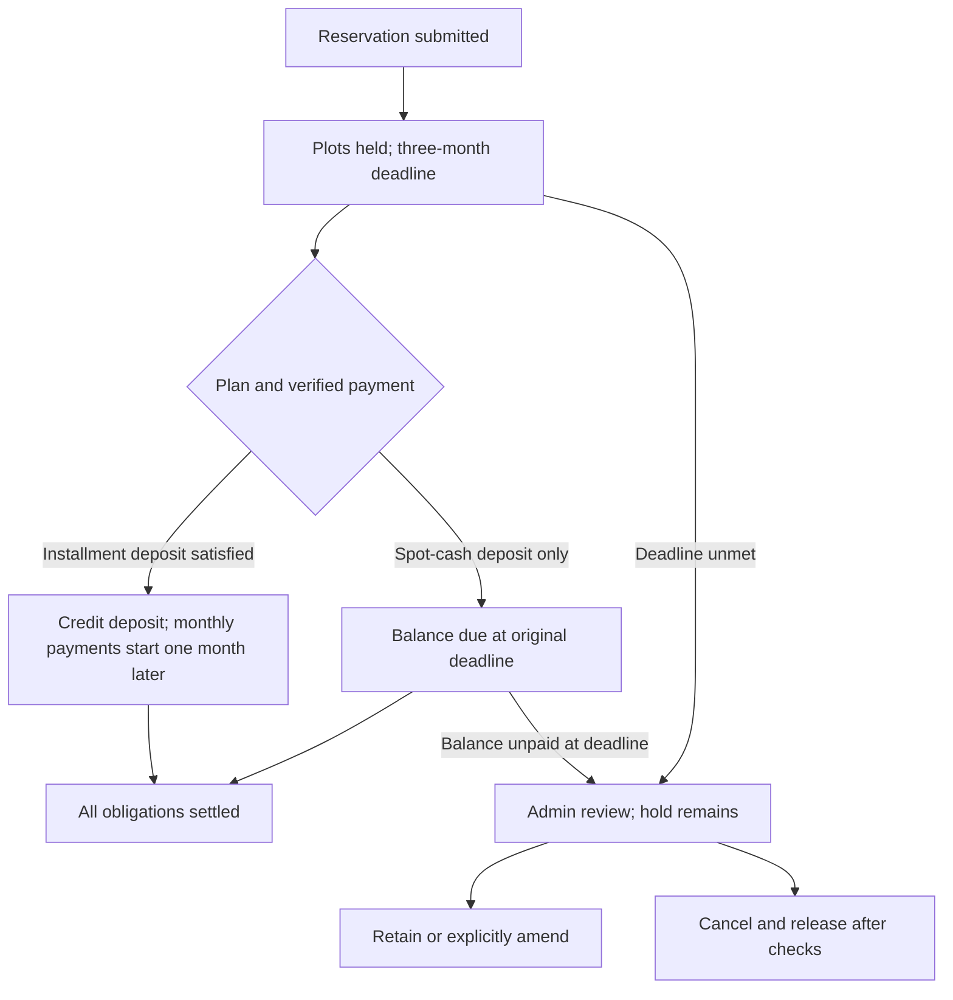

# Payment Feature Blueprint

**System:** Golden Harmonic Memorial Park

**Version:** 2.3 · **Updated:** 2026-10-31 · Asia/Manila

**Status:** Design specification with CP0–CP2 implementation checkpoints. Business decisions marked OPEN are release gates, not approved defaults. The internal foundation and gated read-only access/screens are implemented; the full payment feature is not live.

**Current authorization:** The user selected Option A and explicitly authorized step-by-step application implementation on October 30. This supersedes the earlier blueprint-only edit boundary. Complete a tested checkpoint, save it and pause for review before the next feature. No production deployment, live payment or database migration is authorized by this checkpoint.

**Implementation record:** See [payment checkpoints](docs/payments/checkpoints.md). CP0 captures the baseline; CP1 adds internal server libraries; CP2 adds secure account/guest access and read-only screens with activation disabled by default. CP3–CP9 remain pending. The existing financial posting routes do not yet use the new foundation. CP2 retires the reference/mobile tracker endpoint and requires deployment/rules/contact-version review before activation. The requested QR image is a clearly labeled demo placeholder planned for CP3, not a real payment destination.

> This v2.3 specification retains the original design and baseline comparison, and records the authorized CP1 foundation and CP2 access work. Confirmed user decisions take precedence over source-code behavior and prior proposals. OBSERVED means found in repository source; PROPOSED means a future engineering requirement; OPEN means unresolved and must not be silently implemented. Unless identified as confirmed, observed, or implemented in the checkpoint record, the requirements below describe proposed future implementation.

## 1. Confirmed business decisions

The user confirmed the following during this review:

| Topic | Confirmed answer |
|---|---|
| Payment policy | Keep the current website's policy: no percentage down payment; spot cash or 1/2/3/5-year installment terms; existing surcharges and advertised 2% monthly late penalty |
| Reservation deposit | Keep **₱5,000 per plot**, credited toward the plan/contract price |
| Three-month palugit | A reservation deadline to make the first payment/deposit; after an unpaid deadline, staff review whether to release the plot |
| Start of the three months | Reservation submission date |
| Satisfying the first-payment deadline | Paying the ₱5,000-per-plot deposit within three months satisfies it |
| Installment timing | Monthly installments start **one month after deposit payment**, then follow monthly |
| Plot release | Staff decision after review; **no automatic release** at the deadline |
| Payment channels | Keep PayMongo and add/improve manual GCash, bank-transfer and cash verification |
| Customer scope | Both account holders and presale buyers, with secure access for each |
| Presale access (confirmed October 29) | An email verification link tied to the reservation |
| Manual payment authority (confirmed October 29) | **Only admins** may confirm GCash/bank payments or record cash; existing staff permissions must not carry over implicitly |
| Spot-cash balance (confirmed October 29) | After a deposit, the remaining spot-cash balance is due by the **original three-month reservation deadline** |
| Cash receipt workflow (confirmed October 30) | Keep all four steps: **record pending cash payment → print receipt → upload photo of printed receipt → approve**. Admin-only recording/approval remains confirmed |
| Post-deposit monthly amounts | **Explicitly deferred to business/accountant:** divide the remaining balance over the selected term, or retain the original monthly amount and shorten payoff |
| 2% late-penalty formula | **Explicitly deferred to business/accountant:** calculation details remain undecided |

Wording must distinguish “no percentage down payment” from the retained **credited reservation deposit**. Do not advertise that there is no initial payment, charge the deposit on top of the contract total, or count its credit twice.

**Confirmed timeline example:** reservation submitted November 10, 2026 → deposit deadline February 10, 2027. Deposit paid December 15, 2026 → first monthly installment January 15, 2027. Deposit paid February 10, 2027 → first monthly installment March 10, 2027. No deposit by the deadline → staff review while the plot remains held until a release decision.

Implementation still needs to distinguish actual received date, claimed date, submission date and verification date. Proposed approach: an admin verifies evidence of actual receipt; later verification must not silently move the payment date or penalize timely payment. Partial-deposit acceptance and the anchor for multiple partial payments remain open.

## 2. Review scope, skills and verification limits

Static review covered the public website, cart/inquiries, customer portal, presale reservations, payment tracker, admin CRM and inventory, manual payments, PayMongo checkout/webhook, receipts, customer monitoring-sheet generation, reports, agent allocations, reminders, authentication, hosting configuration and related blueprints.

Applied local skills:

- `.agents/skills/firebase-auth-basics/SKILL.md` and its security-rules reference; a delegated read-only security review was completed under that reference's instructions.
- `.agents/skills/ui-ux-pro-max/SKILL.md`; the payment-form validation search returned focusable error summaries, announced errors and explicit submission feedback.
- `.agents/skills/responsive-design/SKILL.md`; applied to proposed mobile payment/verification requirements.

The initial documentation review changed no application code. The subsequent authorized CP1 adds internal libraries and isolated automated tests as recorded in the checkpoint document. No production payments, database writes, provider actions or deployments were performed. Environment secrets were not read. Deployed Firestore rules, production data, actual billing plans, provider configuration and real receipt samples remain unverified. The historical draft has been replaced; its FR numbering is retired. No deployed configuration or production behavior is certified by this document.

### 2.1 October 30 comparison baseline and verdict

The user explicitly selected **this checkout** for the comparison: branch `presale-system`, commit `b5dd24ef1c309a1c3101126ac2b77e706ca91149` (October 28). At comparison time, only this blueprint had uncommitted changes. The tables below describe that pre-implementation baseline; CP1 additions are tracked separately. No fetch, merge, checkout, or deployment was performed.

**Verdict: the blueprint matches the checkout's architecture and identifies its existing integration points, but the checkout only partially implements the desired payment behavior.** A confirmed requirement or acceptance case in this document is not evidence that it is implemented. The main differences are secure presale access, admin-only money posting, the three-month deposit/balance deadlines, consistent deposit credit and schedules, private payment proofs, and the four-step cash workflow.

Locally available `origin/main` points to `4fe1d4c3e2c4c2d34526c99e925874521cee5fe8` (October 30), with newer cash-receipt, admin-label, reservation-email and FAQ changes. These were inspected read-only as **supplementary branch evidence**, not substituted for the selected checkout or treated as deployed code. Section 3.2 records their integration implications. Remote-tracking refs are local snapshots; their presence does not establish the current remote or live version.

The authentication skill informed the authorization comparison. A fresh UI/UX skill search for payment confirmation/status feedback supported explicit saved/pending/approved messages and irreversible-action confirmation. Responsive skill criteria remain future acceptance requirements; no browser, device, print, accessibility or email-rendering tests were run.

## 3. Existing system and integration map

The actual stack is **React 18 UMD/JSX with Babel standalone, HTML/CSS, Firebase Auth/Firestore compat SDK, Vercel Node.js functions, Firebase Admin SDK, PayMongo and Brevo**. It is not a vanilla ES-module, browser-only application.

| Area | Existing implementation and relevance |
|---|---|
| Runtime | `index.html` loads `presale.jsx` and `site.jsx`; `firebase-config.js` exposes `window.db` and `window.auth` |
| Pricing | `site.jsx:62` and `admin-app.js` define 12/24/36/60-month terms with 10/15/20/30% surcharges; `products` supplies current catalog prices |
| Presale discounts | `api/presale.js` and `presale.jsx`: Regular plots have ₱8,000 spot-cash discount or ₱5,000 installment-base discount; these are distinct from the reservation deposit |
| Leads/orders | `Brochure` and `CartDrawer` create `inquiries`, `customers` and `orders`; an inquiry/order is not automatically a specific plot booking |
| Account portal | `site.jsx:2176` onward uses staff-provisioned Firebase Auth accounts linked by `customers.authUid`, embedded `payments` and `paymentSubmissions` |
| Presale booking | `presale.jsx` and `api/presale.js`: Blocks A–D, 2,000 lots per block, multiple plots per reservation, authoritative server pricing and transactional plot acquisition |
| Presale records | `presaleApplications/{PS-reference}` and `plots/{blockId}_{lotNo}`; preserve source IDs and multi-plot ownership |
| Guest tracker | `my-payments.html` and `api/presale-track.js` use reservation reference plus mobile, without Firebase login |
| Admin payments | `PendingPayments` at `admin-app.js:3446` handles portal references; `PresaleApplications` separately records presale payments, receipts and allocations |
| Gateway | `api/paymongo-checkout.js` and `api/paymongo-webhook.js` serve both customer portal and presale |
| Receipts/sheets | `api/send-ar.js`, `presaleSheetData`, `customerSheetData`, and `CustomerSheetEditor` in `admin-app.js`; acknowledgements and customer monitoring sheets depend on existing ledgers |
| Reports | `presaleDeposits`, `presaleEodReports`, `presaleSettings/allocation`; collections, sales, VAT and fund-allocation views |
| Agents | `agents`, `agentCommissions`, `api/send-agent-commissions.js`; first-payment allocations and 11/12-month commission notifications/due dates |
| Roles | Existing authority is `users/{uid}.role`: `staff`, `admin`, `superadmin`; do not introduce a conflicting `admins` authority |
| Email/jobs | Brevo server functions and existing Vercel daily crons; `emailjs-config.js` is deprecated, although stale conditional EmailJS calls remain in public lead/order code |
| PWA/preview | Service workers mostly pass requests through; installation does not establish offline payment support. Static `serve` cannot execute Vercel APIs |
| Other blueprints | `blueprint.md` proposes self-registration not present in the current portal; `blueprint-payment.md` documents PayMongo; `blueprint-migration.md` explicitly cancels Supabase migration |
| Publication dependencies | `terms.html` retains a seven-day hold/placeholders; `privacy.html` still names EmailJS; public refund wording is inconsistent. Leave these files unchanged in this task |

No deployable `firestore.rules`, `firestore.indexes.json`, or `firebase.json` was found in the baseline inventory. `package.json` has `serve` and `firebase-admin` dependencies; the baseline had no application test/build scripts. CP1 adds only `test:payments`, with no new dependencies or build system. Planning-document rules do not prove deployed access controls.

### 3.1 Requirement-to-checkout comparison

All rows below refer to `b5dd24e`, not the supplementary branch.

| Requirement | Checkout result | Source evidence / remaining work |
|---|---|---|
| Retain React/Firebase/Vercel/PayMongo/Brevo | Matches architecture | `index.html`, `firebase-config.js`, `api/`, `vercel.json`; no platform migration needed |
| Spot cash and 1/2/3/5 years, existing surcharges | Present | `site.jsx:PLAN_TERMS`, `api/presale.js`; quote and ledger consistency still need migration |
| Credited ₱5,000 deposit per plot | Partial / inconsistent | `presale.jsx` sends this amount for PayMongo; webhook stores `reservationFeePaid` outside the presale ledger; manual deposit path is not equivalent |
| Three-month deadline and review without automatic release | Not implemented as a lifecycle | Reservation records lack the policy deadline/review model; manual cancellation exists but is not a deadline-review queue |
| First installment one month after actual deposit | Does not match | Presale helpers use first payment plus `floor(paid/monthly)` months; there is no separate credited-deposit anchor |
| Spot-cash deposit first, balance at original deadline | Does not match | `confirmPaid` requires at least the entire spot-cash balance; no original three-month balance deadline is stored |
| Admin-only manual confirmation and cash recording | Not established | `PendingPayments`, customer payment logging and `confirmPaid` remain direct browser write paths exposed without the required per-action admin gate; deployed rules are unknown |
| Account holders and presale buyers | Partial | Account portal exists; presale tracker uses reference/mobile, not the confirmed reservation email-link session |
| Manual GCash/bank proof, correction history and OCR | Not implemented | Portal supports reference submissions; no private image/OCR/revision workflow; presale receiving instructions are unconfigured placeholders |
| Record → print → photograph → approve cash | Not implemented in this checkout | No `cash-receipts.js` or cash-receipt APIs here; see supplementary branch and Section 9.3 |
| Secure PayMongo and one economic credit | Partial / unsafe source paths | Gateway exists, but checkout authorization, fail-closed webhook verification and transactional deduplication remain outstanding |
| Acknowledgements, reports, sheets and reminders | Existing foundations | Brevo AR, monitoring-sheet editor, allocations and presale 3/1-day reminders exist; canonical totals, immutable receipts and durable outbox do not |
| Approved post-deposit amounts and penalty formula | Open policy, not an implementation default | Existing full-total monthly arithmetic and advertised 2% rate do not resolve Q01/Q02 |

Public copy also needs later alignment: `PrePostNeed` still advertises “0–10% down payment,” while pricing says none; `Brochure` advertises a seven-day hold; the checkout renders the FAQ with refund wording that differs from `PrePostNeed`. Confirmed Section 1 policy takes precedence. `Golden_Harmonic_Memorial_Park.html` loads `site.jsx` without the `presale.jsx` script used by `index.html`; alternate entry points need explicit parity checks when the feature is implemented.

### 3.2 Supplementary newer-branch changes — not in the selected checkout

| Change at `origin/main@4fe1d4c` | What is actually present | Blueprint implication |
|---|---|---|
| `489731a` cash receipts | `cash-receipts.js`, `_cash-core.js`, `_fb.js`, `_qr.js`, cash/owner/verification APIs, `receipt.html`, `/receipt` rewrite; `CR-` numbering, print/photo gates, approval and void transactions | Reuse as a starting point if later integrated; user confirmed all four steps, not the branch's staff permissions |
| Cash collections | `cashReceipts`, nested `audit`, `cashReceiptPhotos`, `cashReceiptRequests`, `counters/cashReceipt`; approval also writes legacy `payments[]` | Inventory and reconcile these if present at cutover; they are not the proposed cross-channel canonical ledger |
| Portal/tracker integration | Approved cash receipt links and negative reversal rows; sheet editor blocks some edits/removal of cash-linked rows | Preserve receipt numbers and links; prevent duplicate import and protect all financial fields server-side |
| `05bf3b1` admin language | “Online Payments to Check,” “Cash Payments,” “Presale Reservations,” and tab help | Preserve understandable names and step guidance when implementing the target permissions |
| `ca9e178` reservation email | Larger full-width plot photo beneath reservation reference | Presentation-only change; no new payment/deadline or access policy |
| `49d2e7e` FAQ removal | Removes FAQ navigation/render call; the unused FAQ function remains in source | Do not claim its wording is still displayed on this branch. Other down-payment/seven-day-hold copy remains |

Useful safeguards already exist on that branch: cash creation does not credit the account; print/photo alone do not approve; approval couples receipt status, account credit and audit in one transaction; repeated approval/void returns the existing result; void appends a negative entry. These are improvements over the selected checkout, but do not satisfy the whole blueprint.

Before reusing that branch, address these source findings (none were runtime-tested):

1. **Authority conflicts with confirmed policy.** `_fb.js:staffFromToken` accepts `staff`, `admin`, and `superadmin`; `cash-receipt.js` allows all of them to create/approve. Only void is admin-gated. Require admin checks for record/approve and current-role/revocation handling; retain no legacy staff bypass.
2. **Receipt owner API has a cold-start initialization risk.** `my-receipts.js` calls `uidFromToken` before `getDb`; `_fb.js` initializes Firebase only in `getDb`. With no initialized app, the token helper catches the initialization failure as 401. Initialize the Admin app before verification and test a fresh function instance with a valid token.
3. **Cash still uses legacy policy and dates.** `_cash-core.js` uses the legacy balance/month-count helpers, rejects a spot-cash deposit below its full balance, and posts the approval date as the payment date. It does not implement the confirmed deposit/deadline rules. Separate received, created, printed and approved times; do not let delayed approval shift the installment anchor.
4. **Deduplication is local to a receipt/request.** `cashReceiptRequests` keys are not scoped to actor or checked against a payload hash. The old portal cash claim and direct payment writers remain; they can represent the same receipt twice. Introduce shared economic identity and writer routing; a changed retry must conflict, not silently return an unrelated earlier receipt.
5. **Plot checks remain incomplete.** Cash approval reads whether plot documents exist, then clears `hold`; it does not verify their current reservation owner. Preserve the atomic operation but add ownership/version checks for every affected plot.
6. **Proof storage needs hardening.** Photos overwrite one document instead of retaining immutable revisions. Validation checks a JPEG prefix and length, not decoded dimensions/content. The allowed 1,100,000-character base64 payload can exceed Firestore's 1 MiB document limit before metadata. Apply the Section 14 hard stored-size and decoded-image bounds; preserve evidence revisions.
7. **Receipt access is a separate security decision.** The QR uses a persistent bearer token, not a reservation email session; reference/mobile tracker access returns that token. Public verification exposes `purpose`, which includes optional free text, so masking the name alone does not guarantee a privacy-safe response. Define a minimal allowlisted public projection, trusted URL origin, token revocation and explicit no-referrer handling; keep full records/photos behind authenticated scope. See Q14.
8. **Queue and edit protection are incomplete.** Client search reads whole collections; receipt list reads the latest 500 then returns at most 200 after filtering, without a cursor, so older pending records can disappear. The sheet guard checks cash-linked amount/reference but does not make the record immutable against other fields or writers. Use server-filtered pagination and ledger-backed amendments.
9. **Receipt presentation and failure messages overstate certainty.** Portal says “Official cash receipts” without resolving Q10. Print logging occurs before the browser print dialog, so print count proves an attempt, not a physical print. An API failure after a committed operation can still say “Nothing was changed.” Display pending/approved/void status clearly, distinguish print attempts and retrieve the saved operation after an uncertain response.

The PayMongo checkout/webhook and core reminder calculations were unchanged by these newer commits. Their existing findings remain applicable. Cash receipt approval does not yet create a durable email outbox, and receipt links/photos do not implement customer GCash/bank proof or OCR.

## 4. Findings and required remediation

These are observed source risks, not claims about exploited production vulnerabilities. Record fixes as future implementation work only.

1. **Webhook fails open without a signing secret.** `api/paymongo-webhook.js:46–50` returns true for absent/placeholder secret. Require fail-closed verification against exact raw request bytes and the intended test/live environment.
2. **Checkout lacks target authorization.** `api/paymongo-checkout.js:29–44,98–110` accepts caller-selected customer/presale targets and amounts without ID-token verification. Authenticate the payer, authorize the contract, calculate the quote server-side and persist an immutable checkout intent.
3. **Webhook posting is not atomic.** At `api/paymongo-webhook.js:217–312`, deduplication read, ledger changes, plot batch and final marker are separate. Concurrent/retried events can double-credit; stale events can revive cancelled/reassigned plots. Use one transactional posting service and deduplicate economic payments across event types.
4. **Presale deposit can be missing from displayed balances.** The webhook stores `reservationFeePaid` and status `verified`, but not the `payments` list used by tracker, reminders, receipts and reports. Reconcile these representations once into a canonical ledger.
5. **Manual presale posting/release also uses separate writes.** `admin-app.js:3973–3998,4088–4093` records money, updates plots and deletes released plots independently. Recheck current ownership and pending payment exceptions in an atomic operation.
6. **Legacy statuses are ambiguous.** Presale `paid` may mean one installment received, not full settlement. Ledger helpers can fabricate a fallback payment from this flag. Do not migrate it directly to `completed` or invent receipts from status.
7. **Inventory readers use existence semantics.** `api/presale.js` GET treats existing plot documents as taken; `admin-app.js:608` recognizes `occupied`, otherwise `reserved`. Adding `available` or `sold` statuses without migrating all readers breaks availability. Financial completion and burial occupancy must stay separate.
8. **Schedules and money calculations differ across readers.** Portal and presale use different anchors and `Date.setMonth`; whole-peso rounding appears in several paths. Share integer-centavo math and Manila calendar dates with original-anchor month-end clamping.
9. **Guest access needs strengthening.** Reference/mobile lookup is not sufficient authorization for private proof access or financial mutation. Add verified account linking or a scoped verified-email session and server-enforced limits. The current reservation API allows up to 100 plots; the intended limit remains open.
10. **Client TOTP is not server-enforced MFA.** Browser verification and visible role controls cannot protect Admin SDK endpoints. Validate explicit role permissions on every privileged operation.
11. **Email success is overstated.** Generic `api/send-email.js` accepts caller-supplied recipients/template data; stale EmailJS calls remain elsewhere. Use fixed payment-event templates and stored recipients. Commit outbox/notifications with the ledger, send afterward, and expose failures/retries. An external email send cannot be atomic with a Firestore batch.
12. **Return URLs do not prove payment.** `site.jsx` displays a success message from `payment_status=success`; require server-confirmed posting before claiming receipt.
13. **Retired v1.1 security sample was unsafe.** It omitted booking ownership and atomic reference/proof linkage, allowed broad resubmission field changes and reference squatting, treated any admin-document existence as full admin authority, and publicly exposed private plot fields. The current blueprint replaces it with explicit invariants and negative tests; it is not evidence of deployed rules.
14. **Reports and arrays need migration planning.** Embedded payment arrays, whole-collection listeners, different receipt paths, customer-sheet editing and existing agent allocations all need compatible ledger readers and a controlled writer cutover.

## 5. Target architecture and design principles

- Retain Firebase, Vercel, PayMongo and Brevo. Use one authorized server-side quote/posting service for manual receipts, cash, gateway events, adjustments and reversals.
- A canonical booking supports multiple plot items and preserves the legacy customer/presale source reference. Snapshot product price, discount, surcharge, deposit policy, schedule version and receiving-account version.
- Normalize payment submissions, proof revisions and ledger entries; use stable IDs rather than timestamps or array position as new payment identities. Preserve legacy IDs during migration.
- Pending proof never reduces the balance. OCR/reference/claimed amount are untrusted evidence. Admins verify actual receipt and record the actual received amount.
- Separate principal/contract credit, penalties, buyer convenience fee, provider fee, settlement, unapplied credit and refund liability. The existing flat 2.5% checkout fee is observed code, not confirmed provider pricing.
- Posting transaction must couple payment deduplication, ledger allocations, booking/deposit state, receipt identity, applicable inventory state, audit and durable notification/outbox records. Send emails outside transaction callbacks.
- Late/unmatched money on released bookings goes to reconciliation/refund review; it must not reclaim a new buyer's plot. Reversal/refund records link to original receipts rather than deleting history.
- At three months, derive or enqueue staff review; do not implement the old lazy expiry, seven-day hold, automatic 48-hour reset or client reclaim logic.
- Preserve QR/download/copy instructions, JPG/PNG/WEBP proof upload, compression, zoom, OCR suggestions and manual fallback. Proposed limits are 5 MB input and a legible ~300 KB compressed target; enforce actual decoded/encoded bounds server-side.
- Store financial evidence privately, separately from payment-list documents. Hash matching flags identical bytes only, not all fraud. Keep revision history and a defined retention/deletion process.
- Maintain existing roles with a clear capability matrix. Only admins may confirm or record manual payments. Other sensitive permissions require explicit capability checks. Account and guest access must both bind to the actual contract.
- Extend the existing portal, tracker and admin queue; show deposit deadline, first monthly due date, pending proof, confirmed credit and balance separately. Include accessible labels/errors, keyboard focus management, announced status, 44px touch targets and narrow-screen layouts.
- Ensure ledger totals agree across portal, tracker, receipts, collections, monitoring sheets and agent allocations. Internal bank deposits and commission payouts are not additional customer revenue.
- Keep acknowledgement receipts distinct from office tax documents. Existing 12% VAT/reporting assumptions and receipt obligations require business/accountant confirmation, not inference from code.

**Illustrative pricing check:** one Regular presale plot at the existing ₱30,000 fallback price, less ₱5,000 installment discount, plus 10% one-year surcharge gives ₱27,500 contract total. After the ₱5,000 credited deposit, balance is ₱22,500. Dividing that balance over 12 months would be ₱1,875/month, but this calculation choice is explicitly **not approved**; retaining the original monthly amount would shorten payoff instead.

**Existing allocation dependency:** source defaults allocate 50% of a 7% agent commission from the first payment, plus 3% of that payment for broker/agent compensation, capped to available funds; later payments go to the company. Preserve historical snapshots and confirm whether the reservation deposit triggers that allocation for both manual and gateway receipts.

## 6. Platform constraints and storage capacity

- Server Firestore libraries bypass client Security Rules, so API authorization is separately required. [Firebase Security Rules](https://firebase.google.com/docs/firestore/security/get-started).
- Firestore free quota includes 1 GiB storage, 50,000 reads/day and 20,000 writes/day; documents are capped at 1 MiB. Managed backup/PITR and TTL operations are not free-quota substitutes. [Firestore quotas](https://firebase.google.com/docs/firestore/quotas).
- Cloud Storage for Firebase requires Blaze; the published requirement took effect starting February 3, 2026. Do not assume a configured bucket means Spark-compatible proof storage. [Firebase Storage requirements](https://firebase.google.com/docs/storage/faqs-storage-changes-announced-sept-2024).
- Base64 makes a 300 KB binary image roughly 400 KB; a few thousand images can consume about 1 GiB before other records/indexes. Firestore proof storage needs hard capacity/retention limits. Public unsigned image uploads are not a private-proof solution.
- Vercel cron availability/precision depends on plan; Hobby schedules are daily with imprecise timing. Existing jobs nominally run at 09:00 and 09:30 Manila. [Cron limits](https://vercel.com/docs/cron-jobs/usage-and-pricing).
- Vercel describes Hobby as personal/non-commercial. Hosting eligibility/budget must be checked separately from Firebase Spark. No actual plan was inspected. [Vercel pricing](https://vercel.com/pricing).

## 7. Pricing, dates and reservation lifecycle

### 7.1 Authoritative quotes

Keep the existing 12/24/36/60-month terms and 10/15/20/30% flat surcharges. Spot cash has no installment surcharge. Quote from current product records and applicable channel discounts on the server; never trust a browser-supplied price or silently use a fallback after a failed authoritative lookup. Store the accepted quote and policy version on the contract.

A reservation of N plots requires a credited deposit of `N × 500000` centavos. Validate it against the quoted total. Distinguish the Regular presale price discount from the same-sized deposit. A deposit is part of contract repayment, not a separate fee.

The post-deposit installment formula is OPEN. Two legitimate options remain: redistribute the balance across the chosen term, or keep the original quoted monthly amount and shorten payoff. New binding installment schedules must wait for an approved policy. The design may expose a read-only illustration, clearly labeled, but cannot publish a payment promise using an invented default. Preserve accepted schedules on existing contracts.

A spot-cash customer may pay in full immediately or make the credited deposit first; all remaining spot-cash principal is due by the original three-month deadline. Paying the deposit does not extend that deadline or convert spot cash into installments.

### 7.2 Calendar and money conventions

- Currency is PHP. Store monetary values as bounded safe integers in centavos. Distinguish contract price, confirmed credit, unpaid principal, penalty charges, fees, unapplied credit and refund liabilities.
- Store audit events as server timestamps. Store due dates as explicit `YYYY-MM-DD` Manila business dates, with a server-derived comparison date. Preserve `claimedPaidAt`, `receivedAt`, `submittedAt` and `verifiedAt` separately.
- Three months means calendar months. Proposed precise cutoff: the end of the due date in Asia/Manila; the next day is past due. Contract wording must disclose this convention.
- Month arithmetic uses the original anchor day, clamped independently to each target month: Jan 31 → Feb 28 → Mar 31. Do not repeatedly add a month to an already-clamped date.
- Once the installment formula is approved, calculate exact centavo schedules with a documented rounding rule and final adjustment. Schedule amounts must sum exactly to the financed balance.
- Deposit payment date means evidenced actual receipt, confirmed by admin or provider. A browser date alone cannot establish it. Later verification must retain the evidenced payment date.
- Partial-deposit policy is OPEN. Proposed anchor if accepted: the receipt that brings cumulative verified deposit credit to the required total. This proposal is not approval to accept partial deposits.
- The advertised 2% monthly penalty is retained, but basis, compounding, grace, charge dates, allocation and waivers remain OPEN. Do not automate charges from this document alone. Unresolved does not mean zero: preserve existing agreed obligations, and block any new binding charge/settlement calculation that needs the missing policy instead of silently waiving it.

### 7.3 Lifecycle

| Trigger | Financial result | Reservation/inventory result |
|---|---|---|
| Successful reservation transaction | Accepted quote and deposit requirement; no credit | All selected plots held; three-month deadline starts |
| Proof submitted or cash code issued | Pending evidence only | Plot remains held; no automatic deadline reset |
| Deposit verified | Credit deposit once; installment anchor established if applicable | Funded reservation; no new three-month payment holiday |
| Installment plan deposit paid early | First monthly installment due one month after payment | Original unpaid-reservation review no longer applies once deposit is satisfied |
| Spot-cash deposit verified | Remaining principal still due at original deadline | Keep hold; do not create monthly obligations |
| Deadline passes unpaid | No invented penalty/receipt | Review queue; no automatic release or reclaim |
| Verified payment completes obligations | Completed financial state | Keep ownership; burial occupancy remains separate |
| Explicit admin release | Preserve payment/refund accounting and audit | Release only currently owned selected plots after exception checks |

For installment reservations, deadline review checks deposit satisfaction. For spot cash, it checks full principal settlement by the original deadline. Pending proof and unresolved gateway payments must be inspected before release. A rejection/resubmission request does not create an automatic 48-hour extension. Any extension is an explicit audited decision; extending a deposit deadline does not silently change an active monthly schedule. Spot-cash extensions require an explicit amendment to the confirmed original-deadline rule, not a default.

No scheduler or lazy-expiry rule may release plots solely because time passed. Provider checkout-session expiry is technical and independent of reservation ownership.

## 8. Identity, roles and secure customer access

### 8.1 Account holders

Verify Firebase ID tokens server-side and bind the request to a verified `customers.authUid` relationship and the requested contract. A customer ID supplied in JSON is not authorization. Do not select an arbitrary first record if duplicate links exist. Support multiple contracts per legitimate customer. Resolve the existing email-verification proposal and legacy account onboarding before enforcing a new account gate.

### 8.2 Presale email verification link — confirmed choice

Reference and mobile may initiate lookup, but do not grant a financial session. Send the verification link only to the address already bound to that reservation. Return a generic response regardless of lookup success; rate-limit by reservation and requester. Never let the caller replace the destination address while requesting access.

Proposed security contract:

1. Generate a cryptographically random, single-use token. Store only its hash with reservation, access version, expiry and purpose; proposed expiry is 15 minutes, configurable. Build the link from a trusted configured site origin, never an unchecked request host.
2. The email link opens a verification page. A GET preview must not consume the token, because email scanners may visit it. Explicit confirmation atomically checks the current access version and consumes the token to create a reservation-scoped session.
3. Remove the token from the address bar after exchange; use `Referrer-Policy: no-referrer` and avoid third-party resources on the exchange page. Never log tokens or put them in localStorage.
4. Use a secure, HttpOnly, SameSite session cookie with expiry and server-side revocation; proposed session lifetime is 30 minutes idle, at most 8 hours. Protect mutation endpoints against CSRF and validate Origin. Browser SDK access to private data is not authorized by this cookie; serve it through the checked API.
5. Authorize only the linked reservation, its payments/proofs and permitted submission actions. A session for reservation A must not open B, even for the same email, without a separately established association.
6. Expired/replayed links fail with a neutral request-new-link flow. Changing contact details requires admin identity review and increments the reservation access version, invalidating both outstanding links and existing sessions. Exchange and later requests check that version, preventing a concurrent exchange from restoring old access. Provide explicit logout/revocation. Account linking must prove control and preserve history; never merge automatically by matching mobile/email alone.

Token durations are proposed technical defaults, not previously confirmed business policy. Full payment details and proof images are served only after authorization, with `Cache-Control: no-store`.

### 8.3 Capability matrix

| Action | Customer / presale session | Staff | Admin authority |
|---|---|---|---|
| Read own contract, status, proof and receipt | Own scope only | Assigned read scope only, to be configured | Authorized business scope |
| Submit/correct own unverified proof | Yes, allowed fields only | No automatic authority to impersonate buyer | Assisted submission with actor/reason |
| Confirm GCash/bank payment or record cash | No | **No — confirmed** | Yes |
| Resolve rejection/resubmission | No | Proposed read/triage only | Yes |
| Change price/recipient account, extend/release, void/refund | No | No | Explicit capability and audit; detailed limits OPEN |
| Change roles | No | No | Separately restricted role-management authority |

Use existing `users/{uid}.role`. Proposed mapping of “admin authority” includes `admin` and `superadmin`; no new cashier role is presumed. Optional second approval and read-only staff scope remain operational decisions. The automated PayMongo processor posts only authenticated provider events for valid intents; it does not grant manual verification to staff.

## 9. End-to-end payment requirements

### 9.1 Manual GCash / bank transfer

- **PAY-01:** An authorized user selects deposit, approved scheduled installment(s), an allowed advance amount, or full settlement. The server returns a versioned quote and permissible amount bounds.
- **PAY-02:** Show approved QR, recipient name/account/bank, amount, deposit or balance deadline, copy buttons, QR download and support details. An unconfigured channel must be disabled with an honest message.
- **PAY-03:** Upload proof, inspect OCR suggestions, enter/correct reference, claimed amount and actual transfer date. Show amount mismatch for review; claimed amount cannot overwrite amount due.
- **PAY-04:** Present one confirmation screen with plots, purpose, due/claimed amount, recipient, reference and proof thumbnail. Confirm creates a stable submission ID and returns saved/pending status.
- **PAY-05:** Use an idempotency key scoped to actor/action, with a request-body hash. Identical retries return the same result; reuse with changed data is a conflict. A timeout must retrieve the original result before advising another submission or payment.
- **PAY-06:** Submission, proof linkage/revision and reference claim are coupled. In object storage, validate a private staged upload first, then atomically attach its immutable object key; clean abandoned uploads after a defined retention period.
- **PAY-07:** Pending proof does not credit money or reset the reservation deadline. Requesting corrections retains the old evidence and creates a new revision under the same payment case.

### 9.2 Admin verification

The oldest-first queue supports status, channel, client, date and age filters, with cursor pagination. Payment detail shows authorized buyer/contract, all plots, quoted purpose, claimed versus received amount, proof zoom, OCR candidates, reference/account version, existing payment history and duplicate flags.

Admin checks reference/evidence, actual receiving account, actual credited amount and funds received in the bank/GCash account. Mismatched amounts require an explicit reconciliation decision; do not require a false “amount exactly matches” checkbox. Record `receivedAt`, actual amount, actor, evidence revision and reason for exceptions.

Actions: verify, reject with reason, request resubmission with note. Accepting a partial payment requires a defined policy; real received money that cannot be applied normally is recorded as unapplied money/exception rather than erased by rejecting its screenshot. Refunds are separately authorized financial actions.

### 9.3 Cash and existing cheques

Buyer cash selection issues an idempotent payment code and instructions, status `awaiting_cash`. This is distinct from an admin recording cash received at the office. A customer statement that cash was paid is not verification.

**Confirmed October 30: retain all four office steps.** Only admins may record and approve; the newer branch's staff access is not approved by this decision.

1. **Record:** admin selects the authorized contract/purpose and records actual amount, evidenced received date, collector and any office document reference. Allocate a stable receipt identity and save `pending_verification`; do not yet credit the account. For actual cash held pending approval, retain a visible cash-on-hand reconciliation record rather than losing the fact that funds were received.
2. **Print:** prepare a visibly pending receipt using that identity. Record the print attempt/reprint and actor; opening or cancelling the browser dialog is not proof of physical printing. Retries/reprints reuse the number and never post money.
3. **Photograph:** upload a legible photo of the printed copy, privately validate it and retain an immutable revision. Replacement before approval preserves the previous revision. Bind the approved evidence revision to the receipt; a customer's transfer screenshot does not substitute for this printed-cash-receipt evidence.
4. **Approve:** admin confirms actual receipt and matching account/details. Server requires the print record and validated photo, then atomically posts the money, receipt state, allocation, audit and notification/outbox through the shared posting service. Repeated approval returns the existing receipt. Due-date calculations use the evidenced received date, not a later approval date.

Do not create a second economic receipt when the provisional printed identity becomes approved. Pending prints must not claim final verified payment; approved views show the confirmed status and voids show the linked reversal. Retain `CR-` numbers if migrating the newer cash module; office tax-document numbering is separate. Prevent the old portal “I paid cash” submission and direct admin writers from crediting the same cash again.

Approval-photo gates do not authorize deleting or ignoring actual money. A cancelled contract, stale amount, illegible photo or unavailable printer creates a visible exception for admin resolution while the funds remain reconciled; no hidden bypass or automatic refund is introduced. Reverse/void through audited linked entries, preserve the original photo and number, and treat handing money back as a separately recorded action.

Cheque exists in the legacy system; preserve its records. New cheque acceptance is OPEN. If retained, record `awaiting_clearance` without contract credit until clearance, and use linked reversals for returned cheques. Do not treat deposit of a cheque as cleared funds.

### 9.4 PayMongo

Persist an authorized `paymentIntent` binding contract/version, purpose, principal, fee, PHP currency and expected provider session. The browser cannot select arbitrary target accounts, prices or credit amounts. Derive contact/return URLs from trusted configuration; keep provider credentials server-side.

Provider creation is an external effect: assign a stable internal attempt key before the call, persist session/result, and reconcile uncertain timeouts before creating another payable session. Do not assume the provider supports an idempotency mechanism without checking its current API.

Verify exact original webhook bytes with the required secret and appropriate signature/environment. PayMongo documents signing `timestamp + '.' + raw body`; parsed/re-serialized JSON is not equivalent. [PayMongo webhook setup and signature verification](https://docs.paymongo.com/docs/developer-tools-webhook-setup-management).

Validate paid state, currency, amount, session/payment ID and stored intent. Deduplicate event ID and economic payment ID, including multiple event types for one payment. Reconcile against manual receipts too: a screenshot of a PayMongo payment and its later webhook describe one receipt even when their submitted identifiers differ. Use verified provider/receiving-statement identity and preserved evidence to link them. Suspected cross-channel matches require admin reconciliation before a second credit; no hash or per-channel key can guarantee detection of every case. Unmatched events are retained in a reconciliation queue, not credited using guessed metadata.

Only acknowledge successful processing after the event is durably posted or accepted into a durable retry queue. If persistence fails, report failure and alert; never drop a verified event behind an unrecorded success response. Reconciliation must recover missed/out-of-order events rather than relying solely on provider redelivery.

Return screen reads the server-confirmed status. Success/cancel query parameters are not payment evidence. A late payment on a cancelled/reassigned booking becomes unapplied money/refund review, never revived plot ownership.

## 10. Status models and integrity rules

| Entity | States and transitions |
|---|---|
| Manual payment | Buyer cash instruction `awaiting_cash` → admin-recorded `pending_verification` → `verified` after print/photo gates; optional cheque `awaiting_clearance` → `verified`/`cancelled`; online proof `pending_verification` → `verified`/`rejected`/`resubmit_requested`; allowed correction → `pending_verification` |
| Posted receipt | Immutable original; `voided` may be a displayed projection of a linked reversal. Partial/full refunds remain separate events |
| Booking | `reserved_unfunded` → `active` when required deposit satisfied → `completed` when obligations settled; full settlement may go directly from `reserved_unfunded` to `completed`; authorized cancellation → `cancelled` |
| Booking review | Separate `reviewStatus` (`none`, `review_required`, `resolved`) and reason; deadline/payment exceptions do not erase the underlying funded state, deposit credit or schedule |
| Installment | `upcoming`, `due`, `partially_paid`, `paid`, `overdue`, derived from schedule, allocated credit and date; pending proof is a separate overlay |
| Physical plot | Ownership/reservation and burial occupancy remain separate. Do not directly map legacy `paid` to occupied or sold |

Completion requires an approved definition of all contractual obligations, not merely all principal schedule rows marked paid. Unknown penalties are not fabricated. Reversal after completion can reopen financial review; it cannot automatically release ownership.

Required invariants:

- Pending/unverified amounts, OCR, client totals and redirects never affect money.
- Every posted receipt has one stable economic identity and one contract; item allocations sum exactly to the credited amount.
- `received = contract credit + penalty/other approved allocations + unapplied credit` for a manual receipt. For gateway receipts, account for charged convenience fee separately; provider settlement/fees must not silently reduce contractual credit.
- Original contract totals and plan/account versions are immutable snapshots; changes require amendments with actor, reason and effective date.
- Deposit credit is included once in total contract credit. Do not subtract both the deposit and the same ledger receipt again.
- Overpayment remains visible as unapplied credit/refund liability instead of disappearing behind `max(0, balance)`.
- Reversals reference original allocations; cumulative reversals/refunds cannot exceed the relevant available amounts. A refund reduces the appropriate liability/credit according to its approved purpose, not an arbitrary balance field.
- Reference claims are scoped to receiving provider/account and normalized reference. The account identity stays stable across configuration versions so editing QR/settings cannot bypass duplicate protection. No cross-customer reference/proof information is disclosed through duplicate errors.
- A reservation release requires current ownership checks for every item, no unresolved payment exception and an explicit authorized decision. Partial release needs a separately approved contract amendment.
- State transitions use expected versions; no normal application path deletes confirmed money, audit records or proof revision history outside approved retention operations.

## 11. Atomic operations and API responsibilities

### 11.1 Transactions

**Reservation:** validate actor/access limits and current quote, read all desired plot locks, create the multi-plot booking and links with deadline and audit; all succeed or none do.

**Submission:** validate owner, current status, limits, sanitized form, proof key and reference scope; write submission/revision/claim, counters and deterministic notification event together. A claim requires a legitimate owned submission and bounded concurrent claim limits, but unverified evidence cannot prove a real payment. Conflicting claims go to admin reconciliation; a malicious pending claim must not permanently block a genuine payer. Corrections preserve history and generic privacy-safe responses.

**Verification/posting:** read current payment, contract/version, intent/economic key where applicable, existing allocations and affected plot ownership; claim uniqueness; write received amount, ledger allocations, summaries/deposit state, affected schedule rows, receipt identity, audit and outbox/notification events atomically. Concurrent review returns the existing result or conflict, not another credit.

**Release:** read booking and plot links plus pending proof/provider exceptions; record authorized cancellation/amendment, history and inventory release atomically. Keep non-sensitive lock records separate from retained financial history if the legacy map still requires deleting a lock document to represent availability.

**Reversal:** validate authority and unreversed amount, append correcting entries, adjust allocations/summaries and set required review state with audit/outbox. No automatic provider refund is assumed.

Transactions must read authoritative documents before writes, stay within actual document/request budgets and avoid unbounded arrays. Scope the maximum plots/installments touched accordingly. If a schedule must be staged, it is not active until complete and validated; never expose a partly generated schedule.

Firestore can retry transaction callbacks, so callbacks must not send emails, call PayMongo, generate new random operation identities on each retry, or mutate UI state. External effects follow a durable intent/outbox. [Firestore transaction contention and retries](https://firebase.google.com/docs/firestore/transaction-data-contention).

### 11.2 Proposed API operations

Names are implementation contracts, not files created in this task. Reuse existing routes where suitable.

| Operation | Authorization | Server responsibility |
|---|---|---|
| Reservation / quote | Verified access or approved booking-onboarding flow | Authoritative price, limits, multi-plot acquisition, policy snapshot |
| Presale access request / exchange | Stored email verification | Generic response, token hash/expiry, one-time exchange, scoped session |
| Payment submit / proof revision | Contract owner | Bounded evidence, claim linkage, idempotency, immutable trusted fields |
| Payment status / proof / receipt | Owner or permitted admin | Filtered response, private delivery, no-store |
| Payment verify / cash record and approve | Admin only | Cash record remains pending; print/photo prerequisites precede atomic approval; trusted received amount/date and audit |
| Checkout create | Contract owner | Quote/fee validation and immutable provider intent |
| Provider webhook | Valid provider signature | Validate intent/payment and post/reconcile once |
| Extend / cancel / reverse | Explicit admin capability | Version, ownership, obligation and exception checks |
| Notification dispatch / reminder scan | Authenticated scheduled worker or authorized admin action | Lease, retries, bounded catch-up queries; no arbitrary recipient supplied by buyer |

Return useful stable error codes for unauthorized/forbidden, invalid input, conflict, oversized image, rate limit and temporary service failure. Do not leak stack traces, private identities or provider secrets. UI retries only safe/idempotent operations; conflicts reload the current state for review.

## 12. Proposed Firestore model and indexes

This is a target schema, not a claim that these collections exist. Keep the current `users` role authority and `customers` profile IDs. Store business evidence, private buyer data and public map data separately. Use bounded immutable documents instead of growing embedded payment arrays.

| Document | Required fields / responsibilities |
|---|---|
| `bookings/{id}` | `schemaVersion`, source kind/ID, owner/customer link, `plotIds`, currency, accepted quote and plan snapshot/version, `totalCentavos`, required/credited deposit, net contract credit, principal balance, unpaid charges, unapplied credit summary, status, review status/reason, `reservedAt`, `firstPaymentDeadlineDate`, `depositReceivedAt`, `depositVerifiedAt`, `firstInstallmentDueDate`, schedule version/state, amendment version |
| `bookings/{id}/items/{itemId}` | Stable plot/product identity, quantity where applicable, list/discount/surcharge/total snapshots, item deposit requirement and credit allocations, ownership/release state |
| `bookings/{id}/installments/{version_seq}` | Sequence, immutable schedule version, Manila due date, amount, applied credit, adjustment references; derive current payment state |
| `bookings/{id}/amendments/{id}` | Authorized term/price/deadline/ownership change, reason, effective date and before/after versions; do not overwrite old schedule history |
| `payments/{id}` | Booking/owner scope, purpose (`deposit`, `installment`, `advance`, `settlement`), source/channel, quote/version, due/claimed/received centavos, claimed/received/submitted/verified times, recipient-account snapshot/version, raw/normalized reference, proof revision, OCR candidates, mismatch flags, status, reviewer and receipt identity |
| `payments/{id}/revisions/{revisionId}` | Immutable claimed form/evidence revision, actor and timestamp, correction request/reason; never rewrite a verified receipt |
| `paymentProofs/{id}` | Booking/payment/revision links, private storage key or bounded image payload, server-validated MIME/dimensions/size/hash, creation and retention metadata; exclude payload from indexes |
| `ledgerEntries/{id}` | Booking/item/payment, kind (`receipt`, `credit`, `charge`, `reversal`, `refund`, `adjustment`), signed centavo effect on explicit accounts, linked original entry, allocations, source event, actor, effective date and recorded time |
| `paymentIntents/{id}` | Authorized booking/version/owner, purpose, expected principal/fee/currency, recipient/provider environment, creation-attempt identity, provider session/payment IDs and processing state |
| `providerEvents/{provider_environment_eventId}` | Unique delivery identity, economic payment ID, received/processed times, posted/reconciliation state and bounded diagnostics; preserve sufficient evidence for recovery |
| `referenceClaims/{key}` | Digest of canonical provider/receiving-account/reference namespace, normalization version, linked payment/revision, active/corrected/blocked state and audit references; backend-only |
| `receipts/{id}` | Immutable acknowledgement number, payment/booking, received date, amount and as-of balance snapshot, office document reference, correction link where applicable |
| Cash workflow records linked to payment/receipt | Stable provisional number, pending/approved/void state, actual received date, print-attempt audit, validated immutable printed-photo revisions and approved revision ID; preserve legacy `cashReceipts`/`cashReceiptPhotos` provenance where applicable, without a second ledger |
| `paymentPlans/{id}` | Immutable version, supported terms/surcharges, deposit/timing policy, approved schedule formula, penalty policy status, effective dates and active flag; incomplete policies cannot be activated |
| `settings/paymentAccounts` and version records | Approved channels, recipient details, QR asset, office information, version/effective dates; admin changes audit-logged |
| `auditLogs/{id}` | Authenticated actor/role, action, targets, reason, server timestamp and bounded before/after changes; append-only through normal APIs |
| `notifications/{eventId}` | Deterministic business event, owner scope, title/body/safe route, created/read state |
| `emailOutbox/{eventId_recipient}` | Stored recipient/template and source event, queued/sending/sent/retry/dead-letter state, attempts, lease, next attempt, provider message ID and safe failure summary |
| `reservationAccess/{tokenHash}` / `reservationSessions/{id}` | Reservation scope and access version, hashed verification/session secret, expiry, consumed/revoked state and purpose; server-only |
| `operationKeys/{scope_key}` | Actor/action, request hash, result identity and state for idempotency; retention must not undermine permanent financial uniqueness |
| `economicPayments/{digest}` (CP1 foundation) | Permanent receipt identity scoped by stable receiving account and verified reference; server-only, independent of temporary operation keys; provider/cross-channel matching is later work |
| `counters/{name}` | Transactional acknowledgement/payment-code numbering; system counters do not replace the office's approved tax-document numbering |

Maintain permanent economic-payment uniqueness independently of short-lived API idempotency records. Store raw references privately and normalize without stripping meaningful digits/leading zeros. A wrong-reference correction reserves the new claim and records the old claim's resolution atomically; it must not permit a second credit or erase evidence of the correction. Exact duplicate-reference behavior must account for account-specific bank formats, not a guessed global GCash regex.

Booking summary fields are projections of ledger entries and are updated by the posting service; the ledger is the audit source. Define sign conventions centrally, including whether an event reduces principal, creates credit liability, settles a refund liability or reverses a prior entry. Never mix fee/commission outflow with customer principal repayment.

**Inventory compatibility:** keep `plots/{blockId}_{lotNo}` IDs and existing absence-means-available semantics until all current writers/readers are migrated together. Public availability must contain only plot identifiers/types/status. Private ownership and financial records survive lock release. A future explicit availability document is acceptable only after the current API/admin readers are updated consistently.

**Indexes to derive from final queries:** payments by booking/time, owner/time, status/submitted time and status/channel/time; bookings by review/deadline and owner; ledger by booking/effective date and channel/collection date; outbox by state/next attempt. Add installment collection-group due-date queries only if needed. Exempt large OCR/proof fields and avoid unnecessary indexes. Cursor-page queues at a proposed 20 records/page; do not listen to all proofs or all customers for pending counts.

## 13. Security rules and privacy contract

Do not copy the old incomplete rules into production. Obtain the deployed rules, map existing browser writes, and build a tested rules file that preserves only intended compatibility. Rules do not filter private fields out of a readable document: separate public/private records.

Proposed final trust boundary:

- Browser clients may read only authorized projections and use explicit submission APIs. They cannot directly create verified payments, alter balances/deadlines/ownership, release plots, write receipt numbers, claim references or edit audit/outbox records.
- An account client's UID must match its established ownership relationship. A guest cookie is checked by server APIs; it is not a Firestore credential.
- Payment metadata and correction endpoints have field allowlists. Buyer edits are restricted to their allowed unverified claim/proof fields; received amounts, identity, quote and financial state are immutable to buyers.
- Every Admin SDK API checks authentication, current server-side role/capability, target ownership/state, types, amounts, sizes and legal transition. Check disabled/revoked Firebase accounts rather than trusting a previously valid login or cached UI role. For sensitive writes, read the current role/capability document within the transaction so a concurrent role removal cannot race past posting authorization. Client Firestore rules cannot protect a privileged server call that omits these checks.
- Only admin authority may confirm or record manual money. Disable or redirect legacy staff posting paths at cutover; hiding a button is insufficient.
- Self-service role changes, arbitrary `authUid` linking, public proof lists, cross-booking reference claims and unchecked contact changes are denied.
- Active reservation/proof caps and rate limits are enforced server-side against concurrency. The business limits are OPEN; the current 100-plot ceiling is not a new approved default.
- Sanitize interpolated content in emails, receipts and printable HTML. Escape spreadsheet formulas on CSV export. Never log tokens, complete image payloads or unnecessary identity details.
- Upload and financial-session endpoints require appropriate Origin/CSRF protections, bounded bodies and generic lookup/conflict responses. CORS is not authentication.
- Account deletion and financial-record retention are separate workflows. A UI restriction alone does not prevent Auth deletion; retained records need access recovery and a documented lawful retention/deletion policy.

Required negative tests include unauthenticated access, wrong owner/guest session, staff verification, forged role fields, arbitrary resubmission edits, proof ID guessing, public plot privacy, webhook/cron forgery, reference squatting, stale release and race conditions. If any browser batch retains financial writes during transition, its rules must enforce coupled before/after invariants and be tested within rule-access limits. Prefer retiring these writes over preserving two incompatible authorities.

## 14. Proof storage and OCR specification

### 14.1 Image lifecycle

Proposed input: JPG/PNG/WEBP, at most 5 MB before compression. Decode and validate real format/dimensions, not just filename/MIME. Bound pixel count to prevent excessive memory use. Resize toward a readable long edge around 1600 px and a ~300 KB compressed target; readability wins over pretending an unreadable image is acceptable. Reject or offer a defined fallback when the chosen storage's hard limit cannot be met.

Server validates encoded size, dimensions, file content and linkage to the authorized booking. Strip unnecessary metadata. Private image payloads never travel in queue/list results. A controlled endpoint or short-lived authorized delivery mechanism serves zoomable proof to its owner and authorized reviewers; no public unsigned upload/delivery design is assumed. Apply these controls to printed cash-receipt photos as well as transfer proofs, with separate evidence types. Include base64 expansion and all metadata in a Firestore document budget; client compression is not a server-enforced storage limit.

A staged upload is not a submitted payment. On confirm, link the immutable validated object/revision to the payment; clean abandoned staging objects after an approved interval. Exact hashes can flag identical bytes for admin review; resized/edited screenshots may evade matching, so hashes cannot prove authenticity or uniqueness of the bank transfer.

Storage provider, hard stored-size limit, proof retention and archival are OPEN. On Spark, separate bounded Firestore documents are a capacity-limited option, not a recommendation for unlimited screenshots. Private object storage requires an approved provider/budget. Define deletion for proofs separately from preserved financial/audit records and prevent retention cleanup from removing evidence under active review.

### 14.2 OCR behavior

Lazy-load a pinned Tesseract.js release and language assets during the upload step; verify current library integration at implementation time. Use a worker, progress status, cancel and a proposed 20-second timeout. Manual entry is always available; OCR failure must not block submission or erase typed values.

Extract reference, amount, date and recipient candidates. Display “Auto-detected — please check,” save candidate/confidence separately from confirmed claim, and distinguish `manual`, `ocr`, `ocr_edited`. Multiple plausible references become suggestions; guessed bank/reference lengths are not hard rejection rules. Tune against sanitized real samples from the actual receiving channels.

Require the buyer to review a complete confirmation screen. Admin verifies actual funds independently. Only store OCR text needed for review; do not retain unrelated sensitive screen content by default.

## 15. Acknowledgements, notifications and reminders

Use existing server-side Brevo, not browser EmailJS. Commit durable in-app notifications and email-outbox records with the business event. A persisted notification is available in the authorized UI, not guaranteed to have been read; provider email acceptance is not guaranteed inbox delivery.

| Event | Customer message | Admin/operational effect |
|---|---|---|
| Reservation created | Plots, total, deposit, three-month deadline and secure access route | New reservation |
| Proof submitted | Stable submission code; awaiting verification, not “money received” | Oldest-first queue and age |
| Cash code issued | Office instructions and payment code; still unpaid | Awaiting cash |
| Cash recorded / printed / photographed | Provisional receipt remains pending; printing is not approval | Admin completes remaining steps; pending received cash remains reconcilable |
| Deposit verified | Acknowledgement, credited amount/balance, installment first-due date or spot-cash original deadline | Funded state and collections |
| Installment/full payment verified | Receipt, balance and next due/completion | Ledger/report update |
| Rejected/correction requested | Specific reason, correction route and unchanged deadline unless amended | Retained revision history |
| Reservation deadline approaching/passed | Deposit/balance obligation; staff review if unmet, not automatic release notice | Review queue |
| Extension/release/cancellation | Explicit decision/reason and financial consequence | Audit and exception handling |
| Void/refund/adjustment | Linked corrected statement and actual resulting balance/liability | Reconciliation |
| Scheduled installment due/overdue | Approved amount, date, and only approved charges | Overdue view |

Outbox worker claims a bounded lease, sends, records provider outcome and retries with backoff/attempt limits. Use stable event IDs and dedupe; reconcile ambiguous responses before retry where possible. Exactly-once inbox delivery is not promised. Admin resend operates on a stored event/recipient, not arbitrary user-supplied addresses. A failure must not roll back an already received payment.

Extend existing cron/reminder infrastructure. Current portal reminders are three days before/after; presale reminders are three/one days before. Final reminder schedule and service turnaround are OPEN. Use catch-up queries so a missed execution does not permanently skip a reminder. Suppress stale reminders after settlement/cancellation; show pending proof to reviewers before automated overdue messaging.

Preserve acknowledgement wording and original receipt numbering from `api/send-ar.js` during migration, and existing `CR-` cash receipt identities if that newer module is integrated. Create immutable as-of receipt snapshots so later payments do not change a past acknowledgement. Store office receipt/invoice reference separately. Tax-document naming/numbering remains a business/accountant decision; a generated acknowledgement is not automatically an official tax document. A QR may verify a narrowly scoped receipt status if Q14 is approved, but never grants access to full history or private photos.

## 16. User experience and responsive behavior

Extend the existing site portal, presale tracker and admin views. Preserve the green/cream/gold visual language. No framework migration, new independent site, or generated design-system files are necessary for this specification.

### 16.1 Buyer screens

1. Contract/plot summary and approved quote; distinguish price discount, credited deposit and processing fee.
2. Clear payment choice: PayMongo, manual GCash/bank, or cash instructions; show available channels only.
3. QR/instructions with copy/download and same-phone guidance; display correct deadline and account version.
4. Image preview and OCR/manual fields; concise privacy/retention notice; progress/cancel/fallback.
5. Review and confirm; explain any amount mismatch and preserve values on validation failure.
6. Saved result with stable ID and honest pending/verified state; retry retrieves status rather than suggesting another transfer.
7. Payment history/schedule with confirmed receipts, pending evidence, remaining balance and next obligation. Detail/acknowledgement is reachable without exposing another contract.

Use distinct labels: **Deposit due by**, **Spot-cash balance due by**, **Next installment due**, **Proof awaiting review**, **Amount credited**, **Reservation under review**. Never say “no payment due for three months” after an early deposit or “reservation released” before the decision is committed.

### 16.2 Admin screens

Review queue with old/overdue items, search/filter, bounded pagination and count; detail with zoom and claimed/received comparison; cash entry with **Record → Print → Photo → Approve** progress and resumable pending records; reservation review; complete ledger/acknowledgements; provider reconciliation; notification failures; versioned plans/receiving accounts; audit and reports. Financial actions remain admin-only even if staff can see assigned customer records. Use the newer branch's plain labels where adopted, while accurately labeling pending receipts and print attempts. Announce saved/failed/approved results, associate labels with inputs, and provide keyboard focus/escape behavior for receipt and confirmation dialogs; CSS responsiveness alone does not establish accessibility.

### 16.3 Skill-derived acceptance requirements

- Proposed minimum control target is 44×44 CSS px, with spacing; readable amounts and body text, scalable to 200% zoom. Test 320/360/390 px mobile layouts and desktop.
- Use content-driven breakpoints, flexible grids and cards. Dense tables may have an explicitly labeled horizontal-scroll region; the overall page must not overflow.
- Visible labels, inline errors, and a focusable error summary linking to fields. Announce errors/OCR/submission changes without noisy repeated announcements.
- Keyboard focus is visible, not hidden by sticky controls; dialogs manage/restore focus, support Escape where safe and have a cancel/back route. Password managers and paste remain available.
- Text and icon accompany color for every status; normal text contrast at least 4.5:1. Preserve reduced-motion preferences; no decorative motion in payment confirmation.
- The user can correct OCR, replace an image, return to a step and retry a failed request without losing valid inputs or duplicating the payment.
- No proof blobs or access tokens persist in localStorage by default. Financial actions require a live server acknowledgement; service-worker installation does not imply offline posting.
- Show plain-language outcome and next action. Keep IDs useful for support but hide internal schema/provider debug information from customer flows.

## 17. Reporting, reconciliation and exceptions

All readers must reconcile to the same ledger and approved schedule as of the same time: portal, presale tracker, admin balance, acknowledgement, customer monitoring sheet and collection reports. A pending and confirmed view of the same receipt is one economic payment, not two.

Required reports: collections by date/channel, contract sales, deposit outstanding, reservation-review list, overdue installments, rejected/correction cases, unapplied funds, refunds/reversals, provider gross/fees/settlements, email failures and payment allocations. Dates use Manila business-day boundaries. PDF/print/CSV exports must preserve security scope and exact totals.

Existing agent/broker allocations and 12% VAT calculations are observed code, not newly approved accounting rules. Preserve recorded allocation/rate snapshots; confirm how the deposit triggers allocations for gateway and manual receipts, and how refunds interact with allocated or already-paid commissions. Do not reset the existing 11/12-month commission clock as a side effect of ledger migration. An internal bank deposit or agent payout is not an additional customer collection.

Customer monitoring sheets should use agreed contract total including applicable surcharge, not accidentally the unsurcharged base price. Financial corrections requested from a sheet editor must become audited amendments/adjustments, not silent historical array edits.

| Exception | Required result |
|---|---|
| Timely payment, late verification | Preserve evidenced received date; examine pending case before release |
| Partial required deposit | Account for funds, keep shortfall visible; do not invent approval/anchor policy |
| Below/above expected payment | Reconcile actual amount; unapplied credit/refund review if necessary |
| Deposit paid, spot balance still unpaid at original deadline | Admin review; do not grant a fresh three months or monthly plan |
| Delayed provider event after release | Durable exception/received-money record; no plot reassignment |
| Reused/corrected reference | Keep scoped claim and revision history; no second credit |
| Two simultaneous admin actions | One transaction wins; other reloads existing result/conflict |
| Contract term change after some receipts | Versioned amendment preserving allocated money, due-date history and customer notice |
| Early payoff | Server quote includes only approved charges/discounts; close schedule once truly settled |
| Reversal after completion | Preserve original receipt; reopen financial review as needed, never automatic plot release |
| Partial cancellation of multi-plot contract | Block until item allocation/refund/amendment policy is approved |
| Auth account removed/contact changed | Retain required money history; recover/reverify access through authorized process |

## 18. Migration and implementation impact

This is a future migration plan, not authorization to run it or change production.

1. Inventory customers, presale applications, plot links, embedded payment/submission arrays, provider transactions, acknowledgements, allocations, commission records and in-flight gateway sessions. Establish the actual deployment commit first. If the newer cash module exists there, also inventory `cashReceipts`, their audit subcollections, `cashReceiptPhotos`, `cashReceiptRequests` and `counters/cashReceipt`. Capture a protected source snapshot with a tested restore procedure.
2. Create deterministic mappings from legacy collection/document/payment identity to new booking/payment/item IDs. Preserve original references, raw values and source provenance. Ambiguous customer linkage requires review, not automatic email/mobile merging.
3. Convert valid pesos to centavos with explicit precision/range checks. Flag invalid/ambiguous dates and amounts. Preserve contracted prices and schedules; do not re-price history from today's catalog.
4. Reconcile `reservationFeePaid`, `paymongoTransactions` and embedded receipts against each other and verified provider evidence. Import each actual receipt once; do not manufacture payments from legacy status/fallback helpers. For newer cash records, join the `CR-` identity to its embedded payment/reversal and import one economic receipt, not both representations as income. Preserve pending prints/photos without granting credit, keep voids/reversal links and allocation snapshots, preserve receipt numbering/counter continuity, and reconcile existing verification links according to the approved access policy.
5. Review opening balances, deposit credit, item ownership, acknowledgement references and agent allocations. Keep old contracts on their established terms unless explicitly amended. The new three-month policy is not retroactive by default.
6. Add new readers/version routing before switching writers. If compatibility projections are needed, generate them deterministically from the canonical ledger; never sum old/new representations together.
7. Use a controlled cutover window or versioned write routing. Retire every legacy payment writer for migrated contracts: portal submission/confirmation, customer manual logging, presale recording, webhook posting and sheet financial saves, plus the newer cash approval/void writer if integrated. Route the four-step cash workflow through the shared service. Remove staff write authority from both APIs and retained direct-write rules.
8. Preserve legacy in-flight provider intents and historical fee quotes; map them to the correct target/version and reconciliation path. Do not force an old paid session through a new amount assumption.
9. Compare balances/receipts/reports for representative portal and presale cases, multi-plot contracts, deposits, partial/overpayments, cancelled records and agent splits. Correct discrepancies through traceable migration fixes.
10. Keep a version-aware rollback plan: preserve new accepted payments; do not restore an old writer that can duplicate already-posted credits. Validate restore and rollback before live cutover.

| Component | Future work |
|---|---|
| `site.jsx` | Quote/deposit copy, authorized submission, canonical history and server-verified return screen |
| `presale.jsx`, `api/presale.js` | Multi-plot deposit quote, three-month dates, source mapping, access onboarding and staff-review state |
| `my-payments.html`, `api/presale-track.js` | Reservation email-link session, protected proof/history and canonical dates/balance |
| `admin-app.js` | Admin-only posting, queue/proof viewer, release/reversal workflow, report/sheet compatibility |
| Newer cash module, if integrated | Preserve four steps and `CR-` identities; fix authority/initialization, proof bounds/revisions, receipt scope, pagination and shared posting; migrate its collections once |
| PayMongo endpoints | Authorized intents, raw-body signatures, shared atomic posting, durable reconciliation |
| Receipt/email/reminder endpoints | Stored events/recipients, outbox, canonical due dates and catch-up execution |
| Shared services / rules / indexes | Money/calendar/policy/posting utilities, versioned authorization and query definitions |
| Terms/privacy and alternate published pages | Later align wording/providers with approved policy; unchanged in this task |

## 19. Delivery phases and release gates

**Phase 0 — policy and baseline:** resolve schedule amounts, penalty formula, partial payments, fees, storage and sensitive permissions; obtain deployed rules, approved receiving details and legacy baseline. Fix the identified checkout/webhook trust weaknesses before expanding real payment usage.

**Phase 1 — financial foundation:** normalized identities/ledger, authoritative quotes, secure presale email access, admin-only shared posting, versioned ownership/state, private proof/manual fallback, four-step cash recording/print/photo/approval, PayMongo integration, acknowledgements, durable notifications and review queue. The newer cash branch is a candidate starting point, not a completed phase or permission to merge.

**Phase 2 — operations and usability:** OCR, QR settings, proof revisions, reminder catch-up, reconciliation, reports, monitoring sheets and commission parity; accessibility/low-bandwidth verification. OCR must not delay a secure manual-entry fallback.

**Phase 3 — optional additions:** second-review thresholds, customer-requested extension workflow, improved duplicate-image heuristics and expanded private storage/automation. No automatic forfeiture/refund, new tax policy or platform migration is introduced implicitly.

Release gates: confirmed financial policy and quote examples; reviewed deployed rules and every legacy write path; tested backup/restore and migration reconciliation; secure provider test/live configuration; private evidence retention; verified permission matrix; completed acceptance cases. Documentation completeness does not mean these implementation gates have passed.

## 20. Acceptance and validation matrix

These are end-to-end acceptance cases for future implementation. CP1 runs isolated foundation tests only; it does not run provider payments, deploy rules or certify these cases in production.

| ID | Scenario | Required result |
|---|---|---|
| A01 | One/multiple plots and every term | Existing surcharge/discount rules preserved; deposit equals ₱5,000 per plot and is credited once |
| A02 | New installment quote with unresolved formula | No binding schedule silently activates; clear policy gate |
| A03 | Reservation Nov 10, deposit Dec 15 | Deposit deadline Feb 10; first installment Jan 15, not three months after deposit |
| A04 | Spot deposit early, remaining balance | Original three-month balance deadline stays unchanged |
| A05 | Deadline passes with unpaid requirement | Review/hold stays; no automatic release, expiry reclaim or silent extension |
| A06 | Timely receipt verified after deadline | Evidenced received date preserved; pending case considered before release |
| A07 | Jan 31, leap year, Manila midnight | Calendar clamping and cutoff correct; no drifting anchor or UTC display mismatch |
| A08 | Buyer/guest wrong booking or replayed email link | No private data or mutation; used/expired token cannot create another session |
| A09 | Staff calls verification/cash API directly | Forbidden even if UI is bypassed; admin succeeds with audited transaction |
| A10 | Buyer changes UID/quote/received amount in payload | Trusted fields rejected or derived server-side, never applied |
| A11 | Duplicate click, network timeout, changed retry payload | Same request returns same ID; changed payload conflicts; no second receipt |
| A12 | Two admins and repeated/multiple provider event types | Exactly one economic credit and acknowledgement |
| A13 | Missing/invalid raw signature, wrong test/live/currency/amount | No credit; failure or durable reconciliation according to event class |
| A14 | Payment success/cancel URL without posted record | UI checks actual state and never claims verified money from URL alone |
| A15 | Paid event races release/reassignment | One ownership-consistent result; actual unmatched funds retained for resolution |
| A16 | Proof MIME/size abuse, OCR timeout/cancel, multiple candidates | Bounded validation; manual fallback; no lost valid fields or trusted OCR amount |
| A17 | Reference squatting, corrected reference, duplicate proof | Coupled authorized claim; immutable correction history; generic privacy-safe warning |
| A18 | Partial/excess receipt, reversal/refund | Explicit balanced allocations, preserved original evidence and no hidden excess |
| A19 | Multi-plot acquisition/release and stale admin action | All-or-nothing bounded transaction; current ownership enforced |
| A20 | Product/plan/account edit after quote/submission | Existing snapshots unchanged; amendment required where appropriate |
| A21 | Email timeout/failure and missed cron run | Payment remains committed; retriable outbox/catch-up, no replayed money mutation |
| A22 | Portal/tracker/admin/receipt/sheet/report comparison | Same as-of balance and deposit credit; fees and commission outflows distinguished |
| A23 | Legacy `paid`, `reservationFeePaid`, duplicate arrays | No invented credit or double import; explicit exception review |
| A24 | Released financial contract versus occupied plot | Financial completion never automatically changes burial occupancy |
| A25 | Small phone, 200% zoom, keyboard/screen reader | Usable fields/actions, announced errors, visible focus and readable totals |
| A26 | Offline mode and browser restart | No silent queued financial action; saved server state retrieved safely |
| A27 | Backup restore and rollback with new payments | No lost/duplicated receipts or re-enabled incompatible writer |
| A28 | Penalty formula still undecided | No invented automatic charge; agreed 2% rate alone is insufficient |
| A29 | Same receipt submitted manually then delivered by gateway | Shared reconciliation links the evidence; no duplicate credit; ambiguous match goes to review |
| A30 | Contact change races link exchange, or admin role is removed | Outstanding links/sessions invalidated; stale role cannot authorize posting |
| A31 | Immediate full payment and funded booking under review | Direct completion works; review flag preserves underlying financial state |
| A32 | Cash record, print, photo, then approval | One stable receipt identity; no contract credit until authorized approval; missing prerequisite is rejected server-side |
| A33 | Cancelled print dialog, reprint, photo replacement and uncertain response | Print attempt is not physical-print proof; no extra credit/number; revisions retained; retrieve saved state before retry |
| A34 | Cash received on deadline, approved later | Received date preserved; pending cash stays visible for reconciliation/release review; schedule does not shift to approval date |
| A35 | Same cash entered through legacy portal/admin path and cash module | One economic credit; migrated contract cannot bypass shared posting through an old writer |
| A36 | Migrate pending, approved and voided `CR-` receipts | Numbers/photos/audit preserved; embedded arrays not counted twice; negative entries and allocations reconcile |
| A37 | Receipt-owner API on a fresh server instance | Valid owner authentication succeeds after initialization; unauthenticated and wrong-owner access still fails |
| A38 | Oversized/invalid cash photo and old pending receipt beyond newest 500 | Bounded server validation; no silent storage failure; cursor queue can reach every authorized pending record |
| A39 | Receipt QR, free-text purpose, revoked token and new guest session | Approved minimal public projection only; no sensitive note/history/photo leak; receipt bearer token never grants reservation access |

## 21. Open decisions and next implementation handoff

The confirmed choices in Section 1 are settled. The following remain open; proposed safeguards and technical defaults elsewhere must not be mistaken for answers to these business questions.

| ID | Decision | Owner / effect |
|---|---|---|
| Q01 | After credited deposit, spread remaining principal/surcharge balance over selected 12/24/36/60 months, or keep the original monthly amount and shorten payoff? | Explicitly deferred by user to business/accountant; blocks binding new installment quote |
| Q02 | 2% monthly penalty basis, grace, charge date, partial months, compounding, cap, rounding, allocation and waivers? | Explicitly deferred by user to business/accountant; blocks automated penalty calculation |
| Q03 | Accept partial deposits/installments? What minimum, deadline treatment and threshold-reaching date apply? | Business; real funds still need accounting even when not sufficient to satisfy an obligation |
| Q04 | Refund/cancellation terms, multi-plot partial release, transfer/co-owner changes, extension limits and default escalation? | Business; no automatic forfeiture or refund, and no invented three-missed-payment rule |
| Q05 | Which admin capabilities may void/refund, extend/release, correct references or change receiving accounts? Second approval threshold and staff read/triage scope? | Management; manual confirmation/cash recording is already settled as admin-only |
| Q06 | Account-holder email-verification rollout and secure linking/recovery for legacy duplicates? | Management/engineering; presale email verification link is already confirmed |
| Q07 | Receiving accounts/QRs, office location/hours, review turnaround and reminder timing? | Operations; avoid placeholder instructions or unapproved service promises |
| Q08 | Does the deposit trigger first-payment agent/broker allocation on both manual and gateway receipts? How do reversals/refunds affect paid commissions? | Business/accountant; preserve historical snapshots until approved |
| Q09 | Continue new cheque acceptance? What clearance/returned-cheque handling? | Business; historical cheque records remain supported |
| Q10 | Buyer convenience fee by channel, provider settlement reconciliation, official receipt/invoice process and VAT applicability? | Business/accountant; current flat fee/tax code is observed, not confirmation |
| Q11 | Strict Spark requirement, private proof provider and hard size cap, retention/archive policy, backup/restore service and hosting budget? | Business/operations; platform requirements in Section 6 constrain options |
| Q12 | Apply new terms only to new contracts or explicitly amend existing unpaid reservations? Active reservation/plot limits and eligible non-presale products? | Business; proposed safe migration preserves existing agreements |
| Q13 | Co-owners/beneficiaries, cross-contract money transfer and at-need exceptions in initial scope? | Business; require explicit ownership/allocation policy before adding |
| Q14 | Keep a limited bearer-link/QR receipt verification page? Which public fields, lifetime/revocation and legacy-link behavior are acceptable? | Management/privacy; four-step cash workflow is confirmed, but public financial disclosure is not; full history/photos require authorized access regardless |

Before implementation, obtain the deployed Firestore rules/index inventory, approved provider/environment configuration, sanitized receipt samples and reconciled legacy baseline. Do not read or expose secrets in documentation. These are verification prerequisites, not claims that the system currently lacks configured credentials or access controls.

### Completion record for the initial documentation task

- v1.1 and the temporary checkpoint have been replaced with a single v2 specification.
- October 28 confirmed deposit/timing/channel policy and October 29 access/admin/spot-cash decisions are incorporated.
- October 30 review uses the user-selected `presale-system@b5dd24e` checkout; newer `origin/main@4fe1d4c` evidence is explicitly separated. The user confirmed retaining all four cash receipt steps, with admin-only recording/approval unchanged.
- The `.agents` authentication, UI/UX and responsive skills informed authorization, form behavior and review criteria.
- Proposed implementation, known source findings and unresolved business decisions are explicitly distinguished.
- Requirement comparison and supplementary cash-module findings are recorded in Sections 3.1–3.2; A01–A39 are future acceptance cases, not executed tests. This review validates documentation consistency, not production readiness.
- The initial review changed **only `payment-feature-blueprint.md`**. The user subsequently authorized Option A implementation; the CP0/CP1 source changes and validation are recorded in `docs/payments/checkpoints.md`.
- Current handoff: CP2 has 43 passing isolated tests and local browser validation; review its gated access/screens, then continue with CP3 when requested. Applicable policy, deployed-rule, contact-version, integration and migration gates still apply; no deployment or migration has been authorized. Consult the checkpoint record for the current implementation rather than treating the earlier baseline tables as current code inventory.
