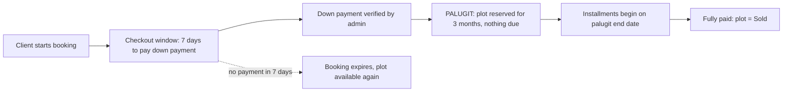
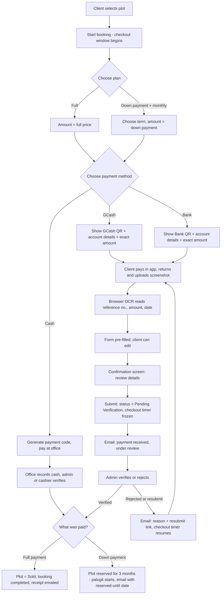
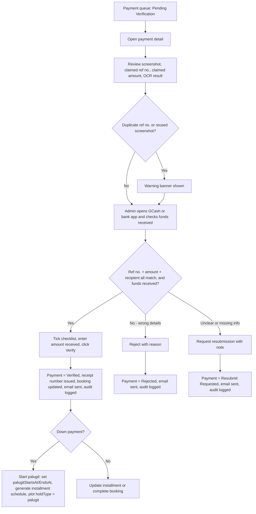
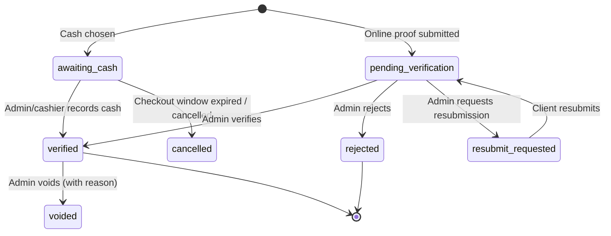
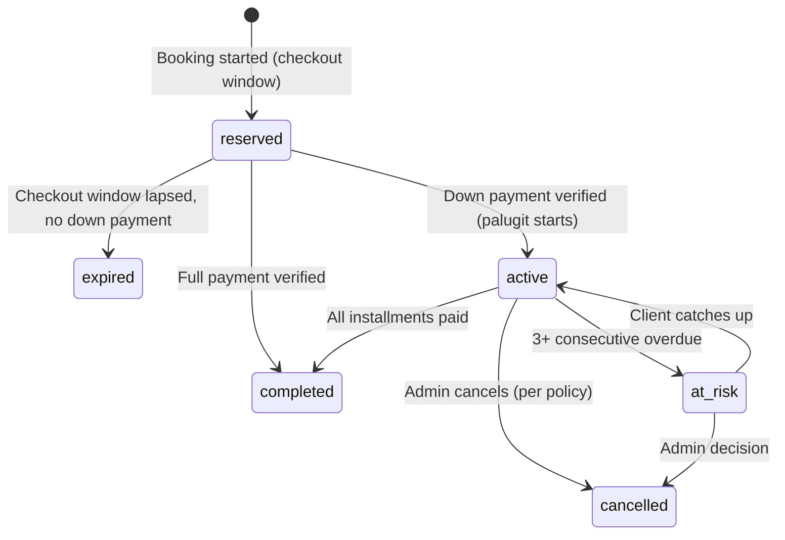

# Payment Feature Blueprint
**System:** Cemetery Plot Reservation & Booking
**Stack:** HTML, CSS, vanilla JavaScript (ES modules), Firebase (Spark / free plan)
**Version:** 1.1 (draft) · **Date:** 2026-10-25

---

## 0. What Changed in v1.1

| Before (v1.0) | Now (v1.1) |
|---|---|
| Plot held for **7 days** while unpaid | After the client's **down payment is verified**, the plot is reserved for **3 months (palugit)** |
| Installments started right after the down payment | **No installment is due during the palugit.** Installments start when the palugit ends |
| One kind of hold | Two stages: **Checkout window** (before down payment) and **Palugit** (after down payment) |
| Hold could expire at any time | Only the **checkout window** can expire. A palugit reservation is never released automatically |

> **Assumption to confirm:** I read "palugit" as a **grace period**: the down payment secures the plot, and the client does not need to pay anything more for 3 months. If you actually meant "the client must finish paying within 3 months or lose the plot", see Section 21, item 1. It is one admin setting, not a redesign.

---

## 1. Overview

Clients reserve a cemetery plot and pay for it using **GCash**, **bank transfer**, or **cash**. Online payments are made by scanning a QR code, then uploading a screenshot. The system reads the reference number from the screenshot (OCR), the client confirms it, and the payment is tagged **Pending Verification**. An admin checks the reference number and amount, confirms the money actually arrived in the GCash or bank account, then verifies or rejects the payment. The client is emailed at every status change.

When the **down payment is verified**, the plot is **reserved for the client for 3 months (palugit)**. After the palugit, the monthly installments begin.

### Goals
- Make paying simple: scan, pay, upload, confirm.
- Cut typing errors with OCR, while always allowing manual entry.
- Give the admin one screen with everything needed to verify a payment safely.
- Keep a complete audit trail. Money and land are involved.
- Run entirely on the **Firebase Spark plan** (no Cloud Functions, no paid services).

### Non-goals (this version)
- No automated payment gateway (PayMongo, GCash API, etc.). Verification stays manual.
- No automatic refunds or automatic forfeiture of plots.

---

## 2. Decisions Made

| Topic | Decision |
|---|---|
| What is being paid for | Cemetery plot reservation and purchase |
| Payment types | Full payment, down payment, monthly installments |
| Tech stack | HTML, CSS, JS, Firebase |
| Firebase plan | **Spark (free) only**, so there are no Cloud Functions |
| Reservation after down payment | **3 months (palugit)**, counted from the day the down payment is verified |
| Time to pay the down payment (checkout window) | **7 days** by default (admin-editable; kept from the earlier decision, see Section 7.9) |
| Installment structure | *Suggested in Section 5; you confirm or adjust* |

---

## 3. Spark Plan Constraints and How This Design Handles Them

There is no backend server, so the browser does the work and **Firestore Security Rules are the real security layer**.

| Need | Normally done by | Spark-compatible solution |
|---|---|---|
| Read ref no. from screenshot | Server OCR API | **Tesseract.js in the browser** (free, runs on the client) |
| Send status emails | Cloud Function + email extension | **EmailJS** (free tier, about 200 emails/month; confirm current limits) sent from the client or admin browser, plus in-app notifications as a fallback |
| Release expired **checkout windows** | Scheduled function | **Lazy expiry**: rules and client logic treat an expired checkout window as available. An admin "sweeper" cleans up on dashboard load (Section 7.9) |
| Know when the **palugit has ended** | Scheduled function | **Computed at read time** (`now >= palugitEndsAt`). No status change or scheduler is needed for installments to begin |
| Palugit-ending and installment reminders | Scheduled function | In-app banners in Phase 1. **Phase 2:** a free **GitHub Actions cron** using the Admin SDK, or an admin "Send reminders" button (Section 12) |
| Store screenshots | Cloud Storage | Cloud Storage may require the paid plan on new projects. **Recommended:** compress the image in the browser (about 300 KB or less) and store it in a separate Firestore document. Alternative: Cloudinary free tier with an unsigned upload preset. *Verify current Firebase pricing before building.* |
| Admin role | Custom claims (needs Admin SDK) | An `admins/{uid}` collection checked in security rules |
| Enforce "only admin can verify" | Server logic | Firestore Security Rules (Section 10) |

**Spark Firestore quotas to design around** (verify current numbers): about 50k reads/day, 20k writes/day, 1 GiB stored. Fine for a cemetery office if we paginate lists, avoid listening to whole collections, and keep screenshots in a separate collection so list screens never download images.

---

## 4. Actors and Roles

| Role | Description | Capabilities |
|---|---|---|
| **Client** | Registered, email-verified user | Browse plots, start a booking, pay, upload proof, view own payments, palugit countdown, and installment schedule |
| **Admin** | Listed in `admins/{uid}` | Verify or reject payments, record cash, extend palugit, manage plans, plots, QR settings, view reports and audit log |
| **Staff / Cashier** *(optional)* | Listed in `admins/{uid}` with `role: "cashier"` | Record cash payments only |

---

## 5. Payment Options and Installment Plan (Suggested)

> The percentages and terms below are **suggestions**. All of them are admin-editable settings (`paymentPlans`), not hard-coded.

### 5.1 Options for the client
1. **Full payment**: 100% of the plot price, paid at once. Once verified, the plot is **Sold**. No palugit is needed.
2. **Down payment + palugit + monthly installments**:
   - Pay the **down payment (default 20%)** within the checkout window.
   - Once verified, the plot is **reserved for 3 months (palugit)**.
   - After the palugit, the remaining balance is paid in equal monthly installments.

### 5.2 Suggested plan terms
| Setting | Suggested default |
|---|---|
| Minimum down payment | 20% of plot price |
| **Palugit (reservation) period** | **3 months** from the down-payment verification date (`palugitMonths`) |
| Installment terms offered | 6, 12, 24, 36 months |
| Interest / add-on | 0% for 6 and 12 months; admin-defined flat add-on for 24 and 36 (default 0% until the business decides) |
| **First installment due date** | **The palugit end date.** Next installments follow monthly (clamped to month end) |
| Grace period after a due date | 7 days before "Overdue" |
| Late fee | Optional, default 0 |
| Early payment | Allowed anytime, including during the palugit. The client can also pay off the whole balance early |
| Paying several months at once | Allowed (client ticks which installments to pay) |
| Palugit extension | Admin may extend (default max 1 extension of 1 month; reason required) |
| Missed installments | After 3 consecutive overdue, flag the booking **At Risk** for admin review. **No automatic forfeiture.** |
| Plot status | **Reserved** from the start of checkout until fully paid, then **Sold** |

### 5.3 Worked example (store all money as integer centavos)
Plot price ₱100,000.00 · 20% down · 12 months · 0% interest.

- Down payment: ₱20,000.00, **verified on 2026-11-10**
- Palugit: **2026-11-10 to 2027-02-10** (plot reserved, nothing due)
- Balance: ₱80,000.00 ÷ 12 = ₱6,666.67 per month
- Installment 1 due **2027-02-10**, installment 12 due **2028-01-10**
- Installments 1 to 11: ₱6,666.67 each; **installment 12 absorbs rounding** = ₱6,666.63
- Total check: 20,000.00 + (11 × 6,666.67) + 6,666.63 = ₱100,000.00 ✅

### 5.4 Timeline



---

## 6. End-to-End Flow

### 6.1 Client flow


### 6.2 Admin verification flow


---

## 7. Functional Requirements

### 7.1 Choose plan and payment method
- **FR-1** The client chooses **Full payment** or **Down payment + monthly**. For installments they pick a term, and the system previews the full schedule, including the **palugit end date** and the **first due date**, before they continue.
- **FR-2** The client chooses one payment method: **GCash**, **Bank**, or **Cash**.
- **FR-3** Always show a summary: plot, plan, amount due now, and the **checkout deadline** (and, for down-payment plans, the note *"Your plot will be reserved for 3 months after your down payment is verified"*).
- **FR-4** The amount due now is **fixed by the system** (down payment, full price, or selected installments). The client cannot change it.

### 7.2 GCash / Bank QR screen
- **FR-5** Show the QR image configured by admin for that method, plus the **account name, number or bank, and exact amount to pay**, each with a "Copy" button.
- **FR-6** Show clear instructions: *"Pay the exact amount, take a screenshot of the receipt, then upload it below."*
- **FR-7** QR images, account names, and numbers come from `settings/paymentAccounts` so admin can change them without editing code. Changes are audit-logged.
- **FR-8** Mobile-first layout. Many clients will scan from another phone or save the QR to their gallery, so provide a **Download QR** button.

### 7.3 Cash
- **FR-9** Choosing Cash generates a **Payment Code** (for example `CPT-2026-000123`) and shows the office address and hours.
- **FR-10** The cash payment is created as `awaiting_cash`. The **checkout window** (default 7 days) still applies to a down payment or full payment.
- **FR-11** An admin or cashier records the cash received: amount, date, **Official Receipt (OR) number**, and received by. Because the cash is physically in hand, it can be marked **Verified** immediately, with the audit log recording who did it. If it is a down payment, the **palugit starts on the day the cash is recorded**.
- **FR-12** Email the client the payment code and instructions, and email again once the cash is recorded.

### 7.4 Upload proof and OCR (GCash / Bank)
- **FR-13** Accepted files: JPG, PNG, WEBP. Max 5 MB before compression.
- **FR-14** The browser compresses and resizes the image (long edge about 1600 px, about 300 KB or less target) before saving.
- **FR-15** After upload, show "Reading your receipt…" and run OCR (Section 11). Pre-fill **Reference Number**, **Amount**, and **Date/Time** when confidence is acceptable.
- **FR-16** Auto-filled fields display a small badge *"Auto-detected, please check"*. All fields stay editable. The client can always type the reference number manually.
- **FR-17** If OCR fails or confidence is low, leave the fields empty with the message *"We couldn't read your receipt. Please enter the details manually."* The flow must never block on OCR.
- **FR-18** Validation before the client can continue:
  - Reference number is required and matches the pattern for the method (Section 11.3).
  - Amount entered must equal the amount due. If different, show a warning and allow submit only if they tick *"I understand the amount differs"*. The admin sees this flag.
  - Screenshot is required.

### 7.5 Confirm and submit
- **FR-19** A **confirmation screen** shows the screenshot thumbnail, reference number, amount, method, date, and plot. The client presses **Confirm and Submit**.
- **FR-20** On submit, create the payment with status **`pending_verification`**. This also **freezes the checkout window** so the plot cannot expire while the admin is reviewing.
- **FR-21** The client sees a "Pending verification" screen with a submission code and an estimated review time. Their dashboard shows the status badge.
- **FR-22** Block double submits (disable the button, idempotent write).

### 7.6 Duplicate protection
- **FR-23** The same **method + reference number** cannot be submitted twice. This is enforced with a `refIndex` document whose ID is `{method}_{normalizedRef}`, created in the **same batch** as the payment. Firestore rules allow the create only if it does not already exist.
- **FR-24** If the same screenshot was already used (SHA-256 hash match), **do not block, but flag** it for the admin.
- **FR-25** If a payment is rejected as "wrong details", the admin may **release** the reference number so the client can resubmit it correctly. If rejected as "suspected fraud", the reference stays blocked.

### 7.7 Notifications
- **FR-26** Send an email and create an in-app notification on each event in Section 12.
- **FR-27** Email failures are logged. The admin can see "email failed" and press **Resend**. The in-app notification is the guaranteed channel.

### 7.8 Admin verification
- **FR-28** The admin has a **Payment Queue**: filter by status, method, date, and client; sorted oldest first; shows pending count and age.
- **FR-29** The payment detail screen shows: client info, plot, booking, plan, what the payment is for (full, down payment, or installment), screenshot (zoomable), **claimed** ref no. and amount, **OCR-detected** values, duplicate and flag warnings, and payment history for the booking.
- **FR-30** Before **Verify** is enabled, the admin must tick the mandatory checklist:
  - ☐ Reference number matches the screenshot
  - ☐ Amount matches the amount due
  - ☐ Recipient account is ours
  - ☐ **Funds confirmed received in our GCash / bank account** (admin checked the actual app or statement)
- **FR-31** The admin enters **Amount Actually Received**.
  - Equal to the amount due → verify normally.
  - Less → admin chooses: *Accept as partial* (balance stays due) or *Reject*. **A down payment below the minimum does not start the palugit** until the minimum is reached.
  - More → admin records the overpayment and a note; the extra is credited to the next installment (or flagged for refund).
- **FR-32** Admin actions:
  - **Verify** → status `verified`
  - **Reject** (reason required, from a list plus free text) → `rejected`
  - **Request Resubmission** (note required) → `resubmit_requested`
- **FR-33** Verification generates a **receipt number** (for example `RCT-2026-000045`) and a printable receipt view.
- **FR-34** Verifying a **down payment** runs these steps in one batch: set `palugitStartsAt` (today), set `palugitEndsAt` (today + `palugitMonths`), generate the installment schedule, set the plot to `holdType: "palugit"`, set booking status `active`, send the "plot reserved until [date]" email.
- **FR-35** Every admin action writes an append-only **audit log** entry (who, what, when, before and after values).
- **FR-36** *(Optional, recommended later)* Payments above a configurable amount need a **second admin** to approve.

### 7.9 Reservation: Checkout Window and Palugit

**Stage A: Checkout window (before the down payment)**
- **FR-37** When a client starts a booking, the plot is held for the **checkout window** (default **7 days**, setting `checkoutWindowDays`) so nobody else takes it while the client pays. Without this, one person could keep a plot locked forever without paying.
- **FR-38** While a payment is `pending_verification`, the checkout window is **frozen** (`holdFrozen: true`). If the payment is rejected or resubmission is requested, the window resumes with **a fresh 48 hours** (configurable).
- **FR-39** **Lazy expiry:** a plot is treated as available if `status = reserved` and `holdType = "checkout"` and `holdFrozen = false` and `holdExpiresAt < now`. Security rules let a new client claim it in that case.
- **FR-40** **Sweeper:** when an admin opens the dashboard, the app finds expired checkout windows and, in a transaction, sets booking → `expired`, plot → `available`, and emails the client. Phase 2 adds the GitHub Actions cron for the same job.

**Stage B: Palugit (after the down payment is verified)**
- **FR-41** The plot is **reserved for 3 months** (`palugitStartsAt` to `palugitEndsAt`). During this time the plot has `holdType: "palugit"` and **cannot be claimed by anyone else**. It is never released automatically.
- **FR-42** **No installment is due during the palugit.** The client may still pay installments early or pay off the whole balance.
- **FR-43** The client dashboard shows a countdown: *"Your plot is reserved until Feb 10, 2027 (3 months, 12 days left)"*.
- **FR-44** **When the palugit ends**, the installment schedule takes over (first installment due on `palugitEndsAt`). This is computed at read time (`now >= palugitEndsAt`), so it needs no scheduler. The default behavior is set by `palugitEndAction = "start_installments"` (alternatives in Section 21, item 1).
- **FR-45** **Extension:** an admin may extend the palugit (default max 1 extension of 1 month). A reason is required, the change is audit-logged, installment due dates shift by the same amount, and the client is emailed. *(Client-requested extensions: Phase 2.)*
- **FR-46** **Reminders** (Phase 2): email at 30, 14, and 7 days before the palugit ends. In Phase 1, show an in-app banner and give admin a "palugit ending soon" list.
- **FR-47** **Cancellation during palugit** is handled manually by an admin, following your refund policy (open item). The plot is released only by an explicit admin action, which is audit-logged.

### 7.10 Installment management
- **FR-48** Installments are generated when the **down payment is verified**, with due dates starting at `palugitEndsAt` and repeating monthly.
- **FR-49** Each installment has a status: `upcoming`, `due`, `pending_verification`, `partially_paid`, `paid`, `overdue`.
- **FR-50** Client "My Payments" page: palugit countdown (if active), schedule table, next due date, total paid, balance, and a **Pay Now** button that starts the same 7.1 to 7.5 flow for the selected installment(s).
- **FR-51** Overdue is computed at read time (`dueDate + grace < today` and not paid). No scheduler required.
- **FR-52** When all installments are `paid`, the booking becomes `completed` and the plot becomes `sold`. Email the client a completion notice.
- **FR-53** The admin can view the full ledger per booking and add a manual adjustment (with reason, audit-logged).
- **FR-54** The client may change the term **during the palugit** (before the first due date). The admin approves, and the schedule is regenerated and audit-logged.

---

## 8. Status Models

### 8.1 Payment


### 8.2 Booking


While `active`, the app **derives** the phase (no extra status to maintain):
- `now < palugitEndsAt` → **Palugit** (reserved, nothing due)
- `now >= palugitEndsAt` → **Paying installments**

### 8.3 Plot
`available` → `reserved` (holdType `checkout`, then `palugit`) → `sold`
Back to `available` on checkout expiry, or on an explicit admin cancellation.

---

## 9. Data Model (Firestore)

All money fields are **integer centavos**. Timestamps are server timestamps. Business dates (due dates, palugit dates) use the **Asia/Manila** timezone, and month math clamps to the last day of shorter months.

```
users/{uid}
  name, email, phone, address, createdAt

admins/{uid}
  role: "admin" | "cashier", name, createdAt

plots/{plotId}
  section, block, lot, type, priceCentavos,
  status: "available"|"reserved"|"sold",
  reservedBy, bookingId,
  holdType: "checkout"|"palugit"|null,
  holdExpiresAt (checkout only), holdFrozen

bookings/{bookingId}
  uid, plotId, planType: "full"|"installment",
  planId, termMonths, totalCentavos, downPaymentCentavos,
  paidCentavos, balanceCentavos,
  status: "reserved"|"active"|"completed"|"expired"|"cancelled"|"at_risk",
  checkoutExpiresAt, checkoutFrozen,
  palugitMonths, palugitStartsAt, palugitEndsAt,
  palugitExtensions: [{ months, reason, extendedBy, at }],
  createdAt, updatedAt

bookings/{bookingId}/installments/{n}
  seq (0 = down payment, 1..N), dueDate, amountCentavos,
  paidCentavos, status, paymentIds[]

payments/{paymentId}
  uid, bookingId, plotId,
  purpose: "full"|"down_payment"|"installment",
  method: "gcash"|"bank"|"cash",
  items: [{ installmentSeq, amountCentavos }],
  amountDueCentavos, amountClaimedCentavos, amountReceivedCentavos,
  referenceNo, referenceNoNormalized,
  refSource: "ocr"|"manual"|"ocr_edited",
  ocr: { refCandidate, amountCandidate, dateCandidate, confidence },
  amountMismatchAcknowledged: bool,
  flags: ["duplicate_image","amount_mismatch","low_ocr_confidence", ...],
  paymentCode (cash), orNumber (cash), receiptNo,
  status, rejectReason, adminNote,
  verifiedBy, verifiedAt, submittedAt, createdAt

paymentProofs/{paymentId}        <- heavy data kept separate
  imageDataUrl (compressed), imageHash, mime, sizeBytes

refIndex/{method_normalizedRef}  <- duplicate guard
  paymentId, uid, createdAt

paymentPlans/{planId}
  minDownPaymentPct, termsMonths[], interestPctByTerm{},
  palugitMonths (default 3), palugitEndAction, maxPalugitExtensions, extensionMonths,
  checkoutWindowDays (default 7), resubmitWindowHours (default 48),
  gracePeriodDays, lateFeeCentavos, active

settings/paymentAccounts
  gcash: { accountName, number, qrDataUrl, active }
  bank:  { bankName, accountName, accountNo, qrDataUrl, active }
  cash:  { officeAddress, hours, active }

notifications/{id}
  uid, type, title, body, link, read, createdAt

emailLogs/{id}
  to, template, relatedId, status: "sent"|"failed", error, createdAt

auditLogs/{id}               <- append-only
  actorUid, actorRole, action, targetType, targetId,
  before, after, note, createdAt

counters/{name}
  value                       <- for OR, receipt, payment-code numbers (transactional increment)
```

**Indexes needed (composite):** `payments` by `status` + `createdAt`; `payments` by `uid` + `createdAt`; `bookings` by `status` + `checkoutExpiresAt`; `bookings` by `status` + `palugitEndsAt` (for the "palugit ending soon" list).

---

## 10. Security Rules (Principles and Sample)

Because there is no backend, **rules must enforce the business logic**.

Principles:
1. Clients can **only create** payments with `status == "pending_verification"` (or `awaiting_cash`) and only for **their own** booking. They can never set `verified`, `verifiedBy`, or `receiptNo`.
2. Only admins can change payment `status`, write installment `paidCentavos`, write `palugitStartsAt` / `palugitEndsAt`, set `holdType: "palugit"`, or write `auditLogs`.
3. `auditLogs` and `refIndex` are **create-only** (no update, no delete).
4. `paymentProofs` readable only by the owner and admins.
5. Plot claims check availability or an expired, unfrozen **checkout** hold using `request.time`. A plot in **palugit** can never be claimed by a client.

Sample (illustrative, not complete):

```js
rules_version = '2';
service cloud.firestore {
  match /databases/{db}/documents {

    function signedIn()  { return request.auth != null; }
    function isAdmin()   { return signedIn() &&
      exists(/databases/$(db)/documents/admins/$(request.auth.uid)); }
    function isOwner(uid){ return signedIn() && request.auth.uid == uid; }

    match /payments/{id} {
      allow read:   if isAdmin() || isOwner(resource.data.uid);
      allow create: if isOwner(request.resource.data.uid)
                    && request.auth.token.email_verified == true
                    && request.resource.data.status in
                       ['pending_verification', 'awaiting_cash']
                    && !('verifiedBy' in request.resource.data)
                    && !('receiptNo' in request.resource.data);
      allow update: if isAdmin()
                    || (isOwner(resource.data.uid)
                        && resource.data.status == 'resubmit_requested'
                        && request.resource.data.status == 'pending_verification');
      allow delete: if false;
    }

    match /refIndex/{key} {
      allow read:   if isAdmin();
      allow create: if signedIn() && !exists(/databases/$(db)/documents/refIndex/$(key));
      allow update, delete: if false;
    }

    match /auditLogs/{id} {
      allow read:   if isAdmin();
      allow create: if isAdmin();
      allow update, delete: if false;
    }

    match /plots/{plotId} {
      allow read: if true;
      allow update: if isAdmin()
        || (signedIn()
            // client may only create a CHECKOUT hold, never a palugit hold
            && request.resource.data.reservedBy == request.auth.uid
            && request.resource.data.status == 'reserved'
            && request.resource.data.holdType == 'checkout'
            // cap at 14 days; the exact window comes from settings
            && request.resource.data.holdExpiresAt <= request.time + duration.value(14, 'd')
            && (
              resource.data.status == 'available'
              || (resource.data.status == 'reserved'
                  && resource.data.holdType == 'checkout'
                  && resource.data.holdFrozen == false
                  && resource.data.holdExpiresAt < request.time)
            ));
    }
  }
}
```

---

## 11. OCR Specification (Browser, Tesseract.js)

### 11.1 Approach
- Load **Tesseract.js** lazily (only on the upload step) from a CDN. Cache the language data.
- Pre-process: resize, grayscale, and contrast boost before recognition.
- Run in a Web Worker so the UI doesn't freeze. Show a progress indicator.
- Timeout after about 20 seconds, then fall back to manual entry.

### 11.2 Fields to extract
| Field | Used for |
|---|---|
| Reference number | Pre-fill input |
| Amount | Compare with amount due, raise a mismatch flag |
| Date / time | Sanity check (not older than the booking) |
| Recipient name or number | Flag if it doesn't match our account |

### 11.3 Reference number patterns (tune with real samples)
- **GCash:** typically a 13-digit number, often shown in groups (for example `1234 567 890123`). Normalize by stripping spaces.
- **Bank / InstaPay / PESONet:** formats vary by bank (alphanumeric, 6 to 20 characters). Use a looser pattern plus the keywords near it ("Reference", "Ref No.", "Trace No.", "Transaction ID").
- Keep the patterns in one config file so they can be updated without touching logic.

> **Action item:** collect 10 to 20 real screenshots from GCash and the banks you use. Tune the regexes and the confidence rules against them before launch.

### 11.4 Confidence and fallback
- Only auto-fill when exactly **one** strong candidate is found near a reference keyword.
- Multiple candidates → show them as tappable suggestions ("Is it one of these?").
- Save `refSource` (`ocr` / `manual` / `ocr_edited`) so the admin knows whether the client changed the OCR result.
- **Never trust OCR as proof.** The admin still verifies against the real account.

### 11.5 Optional Phase 2
Evaluate Firebase AI Logic (Gemini) for better accuracy, but check whether it is available and within quota on the Spark plan before committing.

---

## 12. Email and Notifications

**Provider (Spark-compatible):** EmailJS, called from the browser. Restrict the EmailJS public key to your domain. Never put a private key in client code.

| # | Event | Recipient | Trigger | Content |
|---|---|---|---|---|
| 1 | Booking started | Client | Client | Plot, price, **checkout deadline**, how to pay the down payment |
| 2 | Payment received (Pending Verification) | Client | Client submit | Amount, method, reference no., submission code, "we'll review it" |
| 3 | Payment verified | Client | Admin action | Amount received, receipt no., updated balance |
| 4 | **Down payment verified: plot reserved (palugit)** | Client | Admin action | **Reserved until [date]**, schedule preview, first due date, what happens next |
| 5 | Payment rejected | Client | Admin action | Reason, how to resubmit, new deadline |
| 6 | Resubmission requested | Client | Admin action | Admin's note, resubmit link |
| 7 | Cash code issued | Client | Client | Payment code, office address and hours |
| 8 | Cash received | Client | Admin/cashier | OR number, amount |
| 9 | Checkout window expired | Client | Admin sweeper | Plot released, how to rebook |
| 10 | New payment to review | Admin | Client submit | Link to the queue |
| 11 | **Palugit extended** | Client | Admin action | New reserved-until date, new due dates |
| 12 | Booking completed | Client | Admin action | Congratulations, next steps |
| 13 | Checkout window expiring soon *(Phase 2)* | Client | Scheduler | 2 days left to pay the down payment |
| 14 | **Palugit ending soon** *(Phase 2)* | Client | Scheduler or admin button | 30, 14, 7 days before; first installment amount and date |
| 15 | **Palugit ended: installments begin** *(Phase 2)* | Client | Scheduler or admin button | First due date, how to pay |
| 16 | Installment due soon / overdue *(Phase 2)* | Client | Scheduler or admin button | Amount, due date, Pay Now link |

Rules:
- Every email includes the booking ID, plot details, and a link to the client's dashboard.
- Log each send in `emailLogs`. Failed sends show on the admin payment screen with a **Resend** button.
- Always create the matching in-app notification, so the client is informed even if the email fails.
- Keep the emails short, plain, and respectful in tone; this is a sensitive purchase.

---

## 13. Screens

**Client**
1. Plot selection → Start booking
2. Choose plan (Full / Down payment + term) with schedule preview and palugit dates
3. Choose payment method
4. Pay screen (QR, account details, amount, copy buttons, checkout countdown)
5. Upload proof + OCR result form
6. Confirm and submit
7. Submission result (Pending Verification)
8. My Bookings and My Payments (status badges, **palugit countdown**, installment schedule, Pay Now)
9. Receipt view (printable)

**Admin**
1. Dashboard (pending count, **palugit ending in 30 days**, overdue count, expiring checkout windows, today's collections)
2. Payment queue
3. Payment detail and verification
4. Record cash payment
5. Booking ledger (all payments, installments, palugit dates, extension action)
6. Plans and settings (plans, palugit length, checkout window, QR codes, account details)
7. Reports (daily collection, by method, overdue list)
8. Audit log viewer

---

## 14. Edge Cases

| Case | Handling |
|---|---|
| OCR reads the wrong number | Client sees and edits it; admin sees `refSource` and the screenshot |
| Client pays the wrong amount | Mismatch warning at submit; admin chooses accept as partial or reject |
| Down payment is below the minimum | Admin may accept it as partial, but the **palugit does not start** until the minimum is reached |
| Client pays after the checkout window expired | If the plot is still free, admin can re-reserve it and verify. If someone else took it, admin handles a refund manually (documented process) |
| Two clients try to reserve one plot at the same time | Firestore **transaction** plus rules; only one wins |
| Admin takes days to verify the down payment | Checkout window is frozen while pending, so the client isn't penalized. The **palugit starts on the verification date**, not the submission date |
| Down payment paid in cash | Palugit starts on the day the cash is recorded |
| Client pays the full balance during the palugit | Allowed; booking completes and the plot becomes `sold` |
| Client wants a different term during the palugit | Allowed before the first due date; admin approves and the schedule is regenerated (audit-logged) |
| Client asks for more time at the end of the palugit | Admin extension (max per settings), reason required |
| Down payment payment is **voided** after the palugit started | Admin decision: plot returns to `checkout` hold with a fresh window, or is released. Audit-logged and the client is emailed |
| Client stops paying after the palugit | Overdue → **At Risk** after 3 consecutive misses → admin decides (no automatic forfeiture) |
| Same reference number submitted twice | Blocked by `refIndex` |
| Same screenshot reused | Flagged (not blocked) |
| Edited or fake screenshot | Admin must confirm funds in the real GCash or bank account (mandatory checklist) |
| Client closes the browser mid-upload | Draft state is local; payment is only created on Confirm |
| Admin verifies, then discovers a mistake | **Void** (reason required, audit-logged); booking and installments are recalculated |
| Overpayment | Credited forward or flagged for refund |
| Email fails | Logged, in-app notification still sent, admin can resend |
| Client deletes account | Block deletion if the booking has payments; keep financial records |
| Due date on the 29th, 30th, or 31st | Clamp to the last day of shorter months |
| Admin clock or timezone differences | Use server timestamps for logic; display in Asia/Manila |
| Admin account compromised | Restrict admin creation to manual Firestore edits; consider second-admin approval (Section 7.8) |

---

## 15. Fraud and Risk Controls

- Mandatory "funds confirmed received" checklist before verifying.
- Duplicate reference and duplicate image detection.
- Append-only audit log of every admin action, including palugit extensions and plot releases.
- Amount and recipient mismatch flags.
- Email verification required before booking or paying.
- Limit on active checkout holds per client (for example 1 to 2), so one person cannot tie up many plots without paying.
- Rate limit: maximum open pending payments per client (for example 3).
- Optional second-admin approval above a set amount.
- Store only what's needed. Screenshots contain personal data, so restrict access to the owner and admins in line with the **Philippine Data Privacy Act (RA 10173)**. Add a privacy notice at upload.

---

## 16. Reports (Admin)

- Daily and monthly collections, by method
- Pending verification list with age
- **Palugit ending soon** (next 30 days) and **bookings currently in palugit**
- Overdue installments and At Risk bookings
- Plots by status (available, reserved, sold)
- Rejected payments by reason
- CSV export (generated in the browser)

---

## 17. Non-Functional Requirements

- **Mobile-first**, works on low-end Android phones.
- OCR step must not block the flow and must be cancellable.
- Keep Firestore reads low: pagination (20 per page), no full-collection listeners, screenshots in a separate collection.
- Accessible forms: labels, error messages, large tap targets.
- Money is handled as integer centavos and formatted as `₱#,##0.00`.
- All admin actions are idempotent and transaction-safe.
- Back up Firestore regularly (manual export or a scheduled job from GitHub Actions in Phase 2).

---

## 18. Suggested Project Structure

```
/public
  index.html
  plots.html
  booking.html
  pay.html
  my-payments.html
  receipt.html
  /admin
    dashboard.html
    payments.html
    payment-detail.html
    cash.html
    bookings.html
    settings.html
    reports.html
    audit.html
  /css
    base.css  components.css  admin.css
  /js
    firebase-config.js
    auth.js
    /services
      plots.js  bookings.js  payments.js  installments.js  palugit.js
      notifications.js  email.js  audit.js  settings.js
    /ocr
      ocr.js  patterns.js  preprocess.js
    /utils
      money.js  dates.js  hash.js  image-compress.js  validators.js
    /pages
      pay-page.js  my-payments-page.js
      admin-queue-page.js  admin-detail-page.js
firestore.rules
firestore.indexes.json
firebase.json
```

---

## 19. Delivery Phases

**Phase 1: Core (MVP)**
- Plot booking with checkout window and lazy expiry
- Full payment and down-payment plans
- **Palugit start on down-payment verification, 3-month reservation, schedule generation**
- GCash, Bank (QR), and Cash flows
- Screenshot upload with compression, OCR pre-fill, manual override
- Confirm → Pending Verification
- Admin queue, detail screen, verify / reject / resubmit, receipt
- Admin **palugit extension**
- EmailJS emails (events 1 to 12), in-app notifications, palugit countdown banner
- Duplicate reference protection, audit log, Firestore rules

**Phase 2: Automation and polish**
- GitHub Actions cron: checkout-expiry sweeper, **palugit-ending reminders**, installment reminders, backups
- Client-requested palugit extension
- Duplicate-image flagging refinements, second-admin approval
- Reports and CSV export
- Better OCR tuning (or Gemini evaluation)

**Phase 3: Scale**
- Move to Blaze plan if volume grows (Cloud Functions, server-side email, Cloud Storage)
- Optional payment gateway for auto-verification

---

## 20. Acceptance Checklist

- [ ] Client can pick Full or Down payment + term and see the schedule, palugit end date, and first due date
- [ ] GCash and Bank show QR, account details, exact amount, copy buttons
- [ ] Uploading a screenshot pre-fills the reference number when readable
- [ ] Client can manually enter or edit the reference number at any time
- [ ] Confirmation screen appears before submit; submit creates `pending_verification`
- [ ] Checkout window freezes while pending; resumes on reject or resubmit request
- [ ] Duplicate reference number is rejected at submit
- [ ] Client receives emails and in-app notifications on every status change
- [ ] Admin can verify only after completing the checklist and entering the amount received
- [ ] Verifying a **down payment** starts a 3-month palugit, sets the plot to palugit, and generates the schedule
- [ ] During the palugit, **no other client can claim the plot** (rules tested)
- [ ] Client dashboard shows the palugit countdown, and no installment is due until it ends
- [ ] First installment is due on the palugit end date
- [ ] Admin can extend the palugit with a reason; due dates shift and the client is notified
- [ ] Verify generates a receipt number and updates the booking
- [ ] Reject and Resubmit require a reason and notify the client
- [ ] Cash flow generates a code; cashier or admin records OR number
- [ ] Clients cannot verify payments or edit other users' data (rules tested)
- [ ] Expired unfrozen **checkout** windows can be claimed by another client
- [ ] Every admin action appears in the audit log
- [ ] Works on a small Android phone over a slow connection

---

## 21. Open Items to Confirm

1. **What happens when the palugit ends?** Default in this blueprint: **installments begin** (palugit is a grace period). Alternatives, selectable through `palugitEndAction`:
   - `balance_due_in_full`: the whole balance must be paid by the palugit end date.
   - `lapse`: the reservation ends unless the client has completed payment (the plot returns to available, with admin review).
2. **Checkout window length** (time to pay the down payment): 7 days is used as a default. Change it or tell me if you want no pre-payment hold at all.
3. **Palugit start date:** blueprint uses the **down-payment verification date**. Confirm that is what you want.
4. **Plan numbers:** minimum down payment %, offered terms, interest or add-on, late fees, grace period (Section 5 is a suggestion).
5. **Refund policy:** is the down payment refundable if the client cancels during the palugit? Fully, partly, or never?
6. **Missed payments:** what happens after "At Risk"? Notice period, forfeiture, refund rules.
7. **Official receipts:** is a system-generated receipt enough, or do you issue BIR-registered ORs? Confirm with your accountant.
8. **Screenshot storage:** Firestore (compressed) or Cloudinary free tier. Check current Firebase Storage requirements.
9. **Who can verify:** one admin or several? Is a cashier role needed?
10. **Review turnaround:** what time promise to show clients (for example "within 1 business day")?
11. **Real receipt samples** from GCash and your banks, to tune OCR.
12. **Email volume:** estimate monthly emails against the EmailJS free limit.
13. **Co-owners / beneficiaries:** do bookings need more than one name on the plot?
